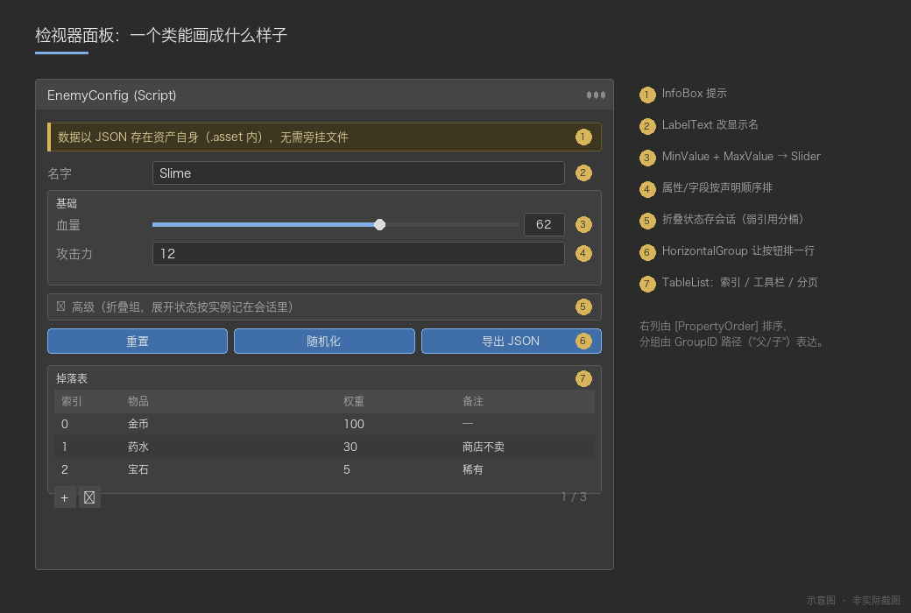
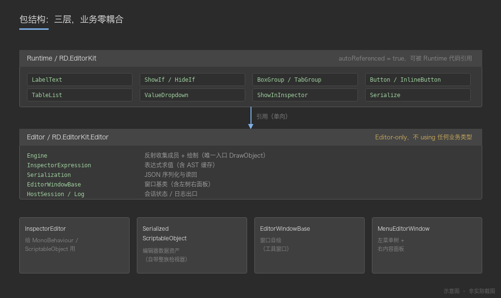
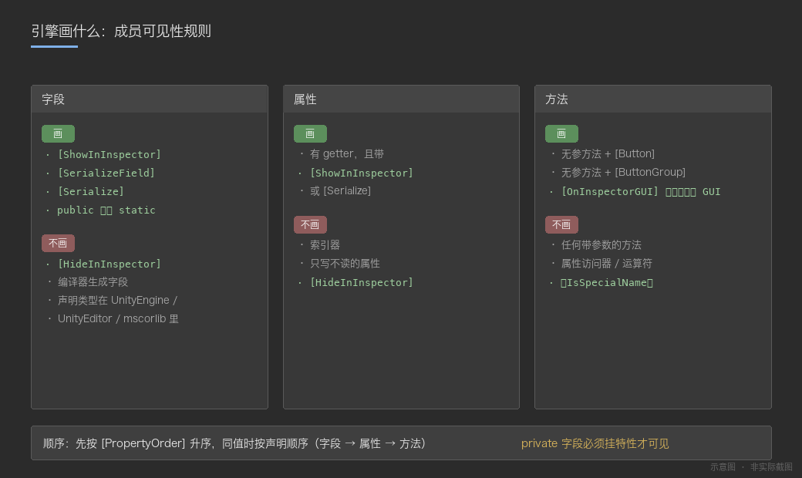
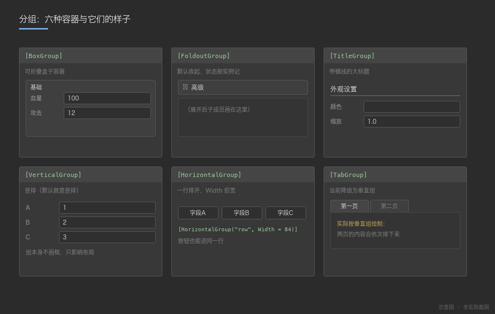
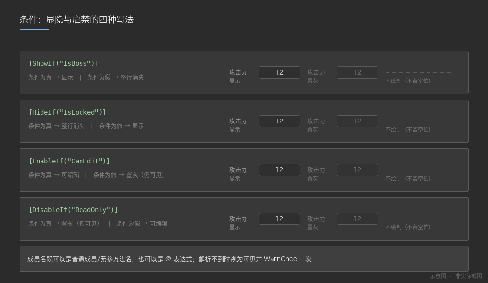
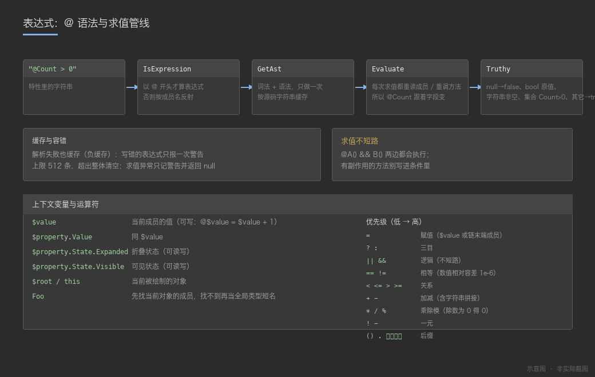

# RD.Draw

`cn.rendu.draw`（displayName **RD.Draw**，version **3.0.0**，最低 Unity **2022.3**）是一个**属性面板绘制引擎包**：不引用任何业务类型，可以整包拎到任意 Unity 工程里直接用。

它提供两样东西：

1. **一套属性特性（Attribute）**（`Runtime/`，纯数据无逻辑）：写在字段 / 属性 / 方法 / 类上，控制编辑器里的显示名、分组、条件显隐、按钮、下拉、表格等；
2. **一套反射式绘制引擎**（`Editor/`）：唯一入口 `Engine.DrawObject`，把任意对象（`MonoBehaviour` / `ScriptableObject` / 普通 C# 对象 / 窗口自身）画成一张属性面板。引擎把控件画进一棵 UIElements（保留模式）控件树，包内只有一个 UIElements 绘制后端（见 §2.4）。

> 引擎之上分三层，都只依赖本包：**cn.rendu.serialization**（序列化层：`SerializedScriptableObject` / `Serialization`）、**cn.rendu.inspector**（检视器宿主：`InspectorEditor` 与资产载体整族的 `[CustomEditor]` 登记）、**cn.rendu.edittool**（工具窗口宿主：`MenuEditorWindow` 等）。两个宿主并列，互不依赖；序列化层同样可被任宿主单独引用。本包程序集名是 `RD.Draw` / `RD.Draw.Editor`；检视器宿主包 cn.rendu.inspector 的程序集是 `RD.Inspector.Editor`（命名空间同名，没跟着改）。

> **第一次使用请先看教程**：[`Documentation~/Tutorial.md`](Documentation~/Tutorial.md) —— 从零接入、到写出自己的工具窗口，按步骤走并有排错手册；本文件是特性手册，适合查阅。
>
> 设计取向：特性名与用法贴近主流检视器的习惯（便于迁移），但**零第三方依赖**（纯 C# + Unity API）。
> 文档里每个特性的"生效情况"都是照引擎源码逐项核对过的实测结论，不是照抄别处文档 —— 哪些参数当前没读取，下文都明确标出。



*图 1：同一个类里的字段、分组、按钮、表格 —— 引擎按特性把它们画出来（示意图，非截图）。*

---

## 目录

- [1. 包结构与程序集](#1-包结构与程序集)
- [2. 三种接入方式](#2-三种接入方式)
- [3. 引擎画什么：成员可见性规则](#3-引擎画什么成员可见性规则)
- [4. 特性速查表](#4-特性速查表)
- [5. 表达式系统（`@` 语法）](#5-表达式系统-语法)
- [6. 编辑器资产序列化：SerializedScriptableObject](#6-编辑器资产序列化inspectorserializedscriptableobject)
- [7. 编辑器窗口与菜单树](#7-编辑器窗口与菜单树)
- [8. 辅助 API](#8-辅助-api)
- [9. 登记检视器](#9-登记检视器)
- [10. 已知限制与注意事项](#10-已知限制与注意事项)
- [11. 完整示例](#11-完整示例)
- [12. 附录：关键实现位置](#12-附录关键实现位置)
- [13. 测试](#13-测试)

---

## 1. 包结构与程序集

```
cn.rendu.draw/
├── package.json                     包元信息（name / displayName / version）
├── README.md                        本文件（特性手册）
├── Documentation~/                  文档资源（Unity 不导入 `~` 结尾的目录）
│   ├── Tutorial.md                  使用教程（怎么用：第 13 章排错、第 14 章选型）
│   ├── images/                      文档配图
│   └── generate_images.py           生成这些配图的脚本
├── Runtime/
│   ├── RD.Draw.asmdef              程序集：RD.Draw
│   └── Attributes/                  特性定义（纯数据、无逻辑），一个类型一个文件，按用途分子目录
│       ├── Core/                       成员元数据：Serialize / ShowInInspector / ReadOnly / Searchable /
│       │                               LabelText / HideLabel / HideMonoScript / HideReferenceObjectPicker /
│       │                               PropertyOrder / DisplayAsString / InlineEditor
│       ├── Groups/                     PropertyGroup(基类) / BoxGroup / FoldoutGroup / VerticalGroup / HorizontalGroup /
│       │                               ButtonGroup / TitleGroup / TabGroup + GroupKind
│       ├── Conditions/                 显隐与可用性：ShowIf / HideIf / EnableIf / DisableIf /
│       │                               HideInPlayMode / HideInEditorMode
│       ├── Constraints/                值的约束：MinValue / MaxValue / Required
│       ├── Appearance/                 外观：LabelWidth / GUIColor / ProgressBar
│       ├── Collections/                集合与表格：TableList / TableColumnWidth / ListDrawerSettings /
│       │                               DictionaryDrawerSettings / DictionaryDisplayOptions /
│       │                               EnumToggleButtons / HideInTables
│       ├── Paths/                      FilePath / FolderPath
│       ├── Text/                       InfoBox / DetailedInfoBox / Title + InfoMessageType / TitleAlignment
│       ├── Events/                     OnValueChanged / OnInspectorInit / OnInspectorGUI / OnStateUpdate
│       ├── Buttons/                    Button / InlineButton + ButtonStyle / IconAlignment / SdfIconType
│       └── Dropdowns/                  ValueDropdown / ValueDropdownItem / ValueDropdownList
├── Editor/
│   ├── RD.Draw.Editor.asmdef       程序集：RD.Draw.Editor（Editor 平台）
│   ├── AssemblyInfo.cs              开放 internal 给测试程序集（不扩公共 API）
│   │
│   │   命名空间与目录一一对应。宿主平时只需要 using RD.Draw.Editor（门面 + 绘制 API）；
│   │   Editor/Components 是额外的一层公开"组合控件"，按需 using RD.Draw.Editor.Components；
│   │   Editor/Selectors 是引擎自带的独立弹窗（类型选择器），按需 using RD.Draw.Editor.Selectors。
│   │   其余分层全部 internal —— 宿主看不到、也不需要知道引擎内部怎么组织。
│   │
│   ├── Api/            (RD.Draw.Editor)            对外门面 + 组合根
│   │   ├── Engine.cs                唯一绘制入口 DrawObject / CreateHostState / 诊断接管 / 值包判定
│   │   ├── EngineServices.cs        组合根：进程级服务装配 + 缓存持有
│   │   ├── HostState.cs             宿主状态的不透明句柄（跨程序集可用）
│   │   ├── HostSession.cs           会话实现：按宿主对象弱引用分桶的折叠/滚动/分页状态
│   │   ├── DrawLog.cs               统一日志出口（含 WarnOnce 去重）
│   │   ├── IDiagnosticSink.cs       诊断输出契约（宿主可换成日志窗口 / 测试断言）
│   │   ├── ExpressionEvaluator.cs   `@` 表达式求值的公开入口
│   │   ├── ExpressionContext.cs     PropertyState / ExpressionContext（$property.State 等）
│   │   └── PropertyAccessor.cs      表达式读写成员的后备通道
│   ├── Drivers/        (RD.Draw.Editor)            唯一 UIElements 绘制后端 + 视觉资源
│   │   ├── Driver.cs             唯一绘制后端（UIElements）：控件词汇表 + 生命周期 + VisualElement 树
│   │   ├── Tree.cs               元素调和：作用域栈 + 按位置复用（保留模式的核心机制）
│   │   ├── Styler.cs             样式施加：复用元素时重刷颜色/禁用态/标签列宽
│   │   ├── Layout.cs             布局语义：占满宽/高、定宽定高 → flexGrow/alignSelf 的唯一出口
│   │   ├── StateStack.cs         外观/交互状态栈，并对外暴露栈顶供上面两者读取
│   │   ├── PaintedSliderMath.cs  自绘滑杆几何：值 ↔ 指针位置（端点/越界/退化区间）
│   │   ├── ReorderDrag.cs        列表条目拖拽排序的拖拽状态
│   │   ├── DrawTextSpec.cs / DrawButtonSpec.cs / DrawAlign.cs / DrawMessageKind.cs
│   │   ├── EditorIcon.cs         内置图标 + SdfIconType → Texture 解析
│   │   └── DrawEmoji.cs          emoji 序列 → 贴图（后端画文本时逐 run 贴图）
│   ├── Theme/          (RD.Draw.Editor)            设计令牌与布局规则（单后端下的唯一真值源）
│   │   ├── IMetricsProvider.cs     运行时度量接口
│   │   ├── EditorMetricsProvider.cs 度量实现（取编辑器默认控件规格，无需皮肤采样）
│   │   ├── RDTheme.cs              设计令牌门面：颜色 / 尺寸 / 间距 / 控件 chrome / 拖拽浮层单源
│   │   ├── LayoutHint.cs           中立的布局描述（渲染器翻译成 style.*）
│   │   └── LayoutPolicy.cs         布局策略（纯函数）：字段 / 按钮 / 标签 / 分组盒 / 工具栏各一份
│   ├── Widgets/        (RD.Draw.Editor)            声明式控件树：平台无关的单一描述
│   │   ├── Widget.cs               节点基类 + 控件分支基类 + 树根（只挂子节点，不画容器）+ Reset 契约
│   │   ├── WidgetPool.cs           节点对象池：按类型分栈、借出即默认值、归还先 Reset
│   │   ├── ContainerWidgets.cs     列 / 行 / 缩进 / 滚动（含测量钩子）/ 空白 / 分隔线
│   │   ├── TextWidgets.cs          标签 / 键值行 / 提示框 / 进度条
│   │   ├── ControlWidgets.cs       按钮 / 折叠 / 各类字段与下拉（交互结果回填字段）
│   │   └── PanelWidgets.cs         表头横条 / 列分隔线 / 列边界 / 卡片 / 拖拽排序 / 外观作用域
│   ├── Components/     (RD.Draw.Editor.Components) 组合控件层：只用驱动契约 + 包内度量拼出来的现成零件
│   │   └── SearchToolbar.cs         一行"搜索框 + 右侧图标键"（悬停说明走 DrawButtonSpec.Tooltip）
│   ├── Selectors/      (RD.Draw.Editor.Selectors)  独立弹窗层：自带 EditorWindow、不经过绘制后端
│   │   ├── TypeSelector.cs          公开入口：NeedsPicker / GetCandidates / Open
│   │   ├── TypeCandidates.cs        候选类型收集（TypeCache + 过滤 + 缓存）与实例化
│   │   └── TypeSelectorWindow.cs    多态类型选择器浮窗（Odin 形态：工具栏搜索 + 分组 / None / 设置三键，↑↓ / Enter / Esc）
│   ├── Metadata/       (RD.Draw.Editor.Metadata)   反射产物与缓存
│   │   ├── CachedMember.cs          成员元数据 + MemberKind
│   │   ├── MemberCollector.cs       成员发现与排序（按类型缓存，跨帧复用）
│   │   ├── GroupNode.cs / GroupEntry.cs  分组树节点与混排项（先 Order 后声明序）
│   │   └── EnumCatalog.cs           枚举显示文本缓存
│   ├── Rules/          (RD.Draw.Editor.Rules)      纯规则：不碰任何 UI
│   │   ├── ITypeShape.cs / DefaultTypeShape.cs            类型形态分类（宿主可替换）
│   │   ├── ILabelFormatter.cs / DefaultLabelFormatter.cs  标签与文案（宿主可替换）
│   │   ├── VisibilityEvaluator.cs   可见 / 禁用判定（表达式与条件特性）
│   │   ├── GroupResolver.cs / GroupTraverse.cs           分组树构建与混排遍历
│   │   ├── ValueAccessor.cs         值读写与方法/字段查找（表达式与绘制共用同一套缓存）
│   │   ├── StateUpdater.cs          [OnStateUpdate] 执行
│   │   └── ValueOps.cs              值语义：真值 / 数值 / 容差相等 / 比较
│   ├── Expressions/    (RD.Draw.Editor.Expressions) `@` 表达式子系统
│   │   ├── Lexer.cs / TokenKind.cs          词法：源码 → 词法单元流
│   │   ├── Parser.cs                        句法：词法单元流 → 语法树
│   │   ├── SyntaxNode.cs / SyntaxKind.cs    语法树节点与种类
│   │   ├── Interpreter.cs                   求值（走 ValueAccessor，与绘制同源）
│   │   └── GlobalTypeIndex.cs               短类型名 → Type 的全局索引
│   ├── Rendering/      (RD.Draw.Editor.Rendering) 绘制流水线
│   │   ├── DrawContext.cs           一次绘制的上下文：后端视图 / 会话 / 变更回调 / 单元格栈
│   │   ├── DrawChain.cs             两条有序责任链的共同机制（+ Nothing 标记）
│   │   ├── InspectorRenderer.cs     编排者兼组合根：递归遍历、成员分发、装配全链、产树→解释收口
│   │   ├── WidgetBuilder.cs         产树器：把原本对后端的即时绘制调用改成 append 节点 + 记录变更
│   │   ├── Renderer.cs             控件树解释器（具体类，树 → Driver 原语）
│   │   ├── IControlRenderer.cs      原生控件边界 + 默认实现（控件 → Driver 原语）
│   │   └── ControlRenderer.cs      自绘实现：Toggle / Slider / Toolbar 自绘，其余退回默认实现
│   │   ├── RenderContext.cs         解释器视角的窄视图 + 本帧点击结果
│   │   ├── ChangeApplier.cs         渲染后回放：值写回 / 折叠态 / 按钮动作
│   │   ├── IMemberDrawHost.cs       渲染器之间"往回画"的回调契约
│   │   ├── MemberRenderChain.cs     成员渲染链：顺序即优先级（IMemberRenderer 各档）
│   │   ├── ValueControlChain.cs     值控件链：顺序即优先级（IValueControl 各档）
│   │   ├── ValueMemberRenderer.cs   值成员骨架：标签宽作用域 + 批注 + [Required] 校验
│   │   ├── MemberRendererBase.cs / ValueControlBase.cs   两链各档的共享骨架
│   │   ├── MemberDrawArgs.cs / ValueDrawArgs.cs          两层的输入包
│   │   ├── AnnotationPainter.cs / ButtonPainter.cs / GroupRenderer.cs
│   │   ├── CollectionRenderer.cs / CollectionMutator.cs / ListPager.cs
│   │   ├── CollapseState.cs         折叠状态的读 / 画 / 比较 / 写回（列表、字典、表格、InlineEditor 共用一份）
│   │   ├── PagingRange.cs           分页区间计算（列表与表格共用一份，含空数据/负页索引的边界不变式）
│   │   ├── ScalarParser.cs
│   │   ├── MemberRenderers/         成员渲染链的各档（InlineEditor / Container / DisplayAsString /
│   │   │                             ProgressBar / EditableValue）
│   │   └── Values/                  每种标量类型一个值画法（策略）
│   ├── Tables/         (RD.Draw.Editor.Tables)     表格：结构推导 + 渲染 + 几何诊断
│   │   ├── TableSchema.cs           列结构推导
│   │   ├── TableColumn.cs           列定义
│   │   ├── TableRenderer.cs         表格绘制（分页、横向滚动、单元格内嵌套绘制）
│   │   └── TableGeometrySink.cs     几何诊断的默认输出（只在数值变化时打一次）
│   └── Resources/Emoji/             emoji 位图资源（按码点命名，如 1f30d.png）
├── Tests/Editor/                    EditMode 测试（程序集：RD.Draw.Tests.Editor，引擎侧 6 夹具 129 例 + 布局策略 14 例 + 控件树/对象池 21 例 + 自绘滑杆几何 8 例 + 值同步 4 例）

检视器宿主（`InspectorEditor` + `SerializedScriptableObject` 整族的 `[CustomEditor]` 注册）在 **cn.rendu.inspector** 包；
编辑器数据资产载体（`SerializedScriptableObject`）与 JSON 读写内核（`Serialization`）在独立的 **cn.rendu.serialization** 包（程序集 `RD.Serialization.Editor`，检视器与窗口宿主都可引用）；
窗口宿主在 **cn.rendu.edittool** 包。
```

### 程序集依赖

| 程序集 | 引用 | 说明 |
|---|---|---|
| `RD.Draw` | 无 | 纯特性定义，Runtime 可用（`autoReferenced = true`） |
| `RD.Draw.Editor` | `RD.Draw` | **Editor-only**。全包没有任何 `[MenuItem]`，也没有任何 `[CustomEditor]`（检视器宿主在 cn.rendu.inspector 包）：画什么、入口在哪，全部由使用方决定 |
| `RD.Draw.Tests.Editor` | 前两者 | 仅测试用；通过 `InternalsVisibleTo` 访问引擎的 internal 元数据 |

> 结论：**Runtime 代码只需要引用 `RD.Draw`**（用特性）；**写自定义宿主的 Editor 代码要引用 `RD.Draw.Editor`**（引擎）；引擎之上分三层，引包即用 —— 序列化 **cn.rendu.serialization**（程序集 `RD.Serialization.Editor`）、检视器宿主 **cn.rendu.inspector**（程序集 `RD.Inspector.Editor`）、工具窗口宿主 **cn.rendu.edittool**（`EditorWindowBase` / `MenuEditorWindow` / `MenuTree` / `EditorPrefsValue<T>`）。后两者并列，互不依赖。
> 如果工程用 asmdef 组织代码，Editor 目录可以通过 **Assembly Definition Reference（`.asmref`）** 归并进自己的 Editor 程序集，从而天然拥有这些能力。

### Components 层（组合控件）

`Editor/Components/`（命名空间 `RD.Draw.Editor.Components`）放**只用公开契约拼出来的现成零件**，它们不属于引擎流水线：

- 只依赖公开契约（`Driver` 的绘制 API / `DrawButtonSpec`）与设计令牌 `RDTheme`，不碰 `Rendering` / `Metadata` / `Tables` 的内部类型；
- 控件与具体后端解耦 —— 差异（tooltip 接线、宽度、图标定位）在驱动层解决，控件里不写宿主特定的判定；
- 不注册菜单 / 检视器、不掺业务语义、不持有跨帧可变状态（文本、开关由调用方保存）；
- 组件之间互不依赖：每个文件都是可以整份删掉、不影响引擎的叶子。

反例：`ListPager` / `CollectionRenderer` 这类"流水线的一部分"不进这层 —— 它们依赖渲染上下文与成员元数据，属于 `Rendering/`。

已有：`SearchToolbar`（搜索框 + 右侧图标键，用法见 §8）。

独立弹窗（类型选择器）**不在这一层**：它们在 `Editor/Selectors/`，自带 `EditorWindow`、独立窗口、不经过绘制后端 —— 那层的规则只有一条：只碰公开契约与 Unity 编辑器 API，不碰引擎内部、不掺业务语义。



*图 2：Runtime 只放特性；Editor 放引擎与引擎之上的组合控件（宿主在另外两个包）；业务类型永远不出现在这套包里。*

---

## 2. 三种接入方式

### 2.1 给 MonoBehaviour / ScriptableObject 接检视器

> `InspectorEditor` 在 **cn.rendu.inspector**（检视器宿主包，程序集 `RD.Inspector.Editor`）；命名空间 `RD.Inspector.Editor` 不变，本节的代码写法照旧。

写一个继承 `RD.Inspector.Editor.InspectorEditor` 的类，用 Unity 原生 `[CustomEditor]` 注册：

```csharp
using RD.Inspector.Editor;
using UnityEditor;

[CustomEditor(typeof(EnemyConfig))]
public class EnemyConfigEditor : InspectorEditor { }
```

用 `true` 一次覆盖整个继承族（子类无需再登记）：

```csharp
[CustomEditor(typeof(EnemyConfigBase), true)]
public class EnemyConfigBaseEditor : InspectorEditor { }
```

`InspectorEditor` 的行为（其源码注释已明确）：

- 内部调用 `Engine.DrawObject(target, null, OnBeforeChange, OnChanged)`，把反射写值前后的时机交给宿主做 Undo / `SetDirty` / 重绘；
- **刻意不做全局注册**（没有 `[CustomEditor(typeof(MonoBehaviour), true)]`），避免替换掉全工程其它脚本的 Unity 原生检视器 —— 用哪个组件要自己显式登记；
- 基类必须写全 `UnityEditor.Editor`：该文件位于 `RD.Inspector.Editor` 命名空间内，简单名 `Editor` 会被解析成 `RD.Inspector` 下的 `Editor` 命名空间，报 CS0118。

### 2.2 编辑器数据资产（ScriptableObject）

> `SerializedScriptableObject` 与序列化器 `Serialization` 在独立的序列化包 **cn.rendu.serialization**（程序集 `RD.Serialization.Editor`，命名空间 `RD.Serialization.Editor`）；`[CustomEditor]` 整族登记在 cn.rendu.inspector。它们不依赖绘制引擎的 internal，只复用引擎公开的成员规则（`Engine.IsUnityValueBagType`）。

编辑器侧的数据资产推荐继承 `SerializedScriptableObject`，把成员标 `[Serialize]`：

```csharp
using RD.Draw;                           // 特性命名空间
using RD.Serialization.Editor;                    // SerializedScriptableObject（cn.rendu.serialization）
using UnityEditor;                        // Editor 程序集里才有的基类

public class MyEditorAsset : SerializedScriptableObject
{
    [Serialize]
    [LabelText("名字")]
    private string m_Name;
}
```

- 基类自带 `[CustomEditor(typeof(SerializedScriptableObject), true)]`，**子类无需自己写检视器**；
- 基类位于 **Editor 程序集**，所以只能用于编辑器资产；**运行时资产不要继承它** —— 运行时资产用 `ScriptableObject` + 公共字段 / `[SerializeField]`；
- 数据细节见 [第 6 节](#6-编辑器资产序列化inspectorserializedscriptableobject)。

### 2.3 编辑器窗口

窗口宿主已迁至独立包 **`cn.rendu.edittool`**（程序集 `RD.EditTool.Editor`，命名空间 `RD.EditTool.Editor`）：`EditorWindowBase`、`MenuEditorWindow`、`MenuTree`、`EditorPrefsValue<T>`。

- 窗口包引用 `RD.Draw` / `RD.Draw.Editor`，用 `Engine.DrawObject` 绘制窗口自身与右侧面板；
- 跨程序集宿主各持独立会话的入口：`Engine.CreateHostState()` 创建不透明状态句柄，绘制时传 `DrawObject(target, host, onBeforeChange, onChanged, state)`，各窗口的折叠 / 滚动状态互不串台；
- 用法详见该包的 README。

> **本包自身不提供任何菜单入口**（全包没有任何 `[MenuItem]`）。窗口入口一律由使用方提供。

### 2.4 绘制后端：单一 UIElements 后端

引擎把控件画进一棵 **UIElements（保留模式）控件树**：规则层先产出声明式 `Widget` 树，`Renderer` 遍历它并调用唯一的 `Driver` 后端把节点翻译成 `VisualElement` 原语。包内只有一个绘制后端（`Driver`），不提供后端切换。

接入时多传一个 `Driver` 即可指定绘制宿主：

```csharp
// 单个窗口: 把窗口的 rootVisualElement 交给引擎, 由 Driver 画进 UIElements
public void OnGUI()
{
    Engine.DrawObject(this, this, OnBeforeChange, OnChanged, new Driver(rootVisualElement));
}
```

`Driver` 是保留模式后端，接之前要知道：

- **需要重绘时必须重新调用 `DrawObject`**。UIElements 是保留模式，数据变了却没有再绘制，界面不会自己更新 —— 窗口宿主在用它时要自己排一次重绘；两个宿主的入口都收在各自包内（cn.rendu.inspector / cn.rendu.edittool），业务代码不用碰，详见各自包的 README。
- **部分能力会降级**：`Label` 不支持富文本（`[DisplayAsString]` 的 richText 按纯文本显示），按钮图标只支持 `Texture2D`。
- 元素按**位置**复用（容器内同一位置仍是同类控件就只更新内容与状态），所以折叠 / 条件显隐变化时不会整树重建，正在输入的输入框不丢焦点；反之中间插入不同控件时那一个会被换掉。

---

## 3. 引擎画什么：成员可见性规则

引擎按类型缓存成员清单（`Dictionary<Type, CachedMember[]>`），规则如下：

### 字段

跳过条件（任一命中即不画）：

- `[HideInInspector]`
- 编译器生成字段（闭包 / 自动属性背后的字段等）
- 成员声明类型所在程序集以 `UnityEngine` / `UnityEditor` / `mscorlib` 开头（框架内部字段，如 `wantsMouseMove`）

显示条件（任一命中即画）：

- `[ShowInInspector]`
- `[SerializeField]`
- `[Serialize]`
- `public` 且**非 static**

> 推论：**private 字段必须挂特性才可见**；**public static 字段默认不显示**（但挂 `[ShowInInspector]`/`[SerializeField]` 即可显示，不必改写成属性）；不带任何特性的 private 字段默认隐藏（与 Unity 原生行为一致，比原生检视器更严格）。另有 `IsEngineInternal` 兜底：声明类型在 `UnityEngine*`/`UnityEditor*`/`mscorlib` 里的成员一律跳过，所以继承 `MonoBehaviour`/`ScriptableObject`/`EditorWindow` 不会把引擎基类字段带进面板。

### 属性

- 必须同时满足：有 getter，且带 `[ShowInInspector]` 或 `[Serialize]`；`[HideInInspector]` 优先跳过。访问器可见性不影响收集（`[ShowInInspector] private int X { get; set; }` 一样会画）。
- 索引器：引擎收集阶段不专门过滤，但要挂标记才会被收集、且读值需要索引实参 → **实践上不要给索引器挂标记**（序列化器则会直接跳过 `GetIndexParameters().Length > 0` 的属性）。

### 方法

- 只有**无参**方法会被收集（带参数的方法直接忽略）。
- 带 `[Button]` / `[ButtonGroup]` → 画成按钮；带 `[OnInspectorGUI]` → 在该位置调用（用来插入自定义 GUI）。
- 属性访问器、运算符等 `IsSpecialName` 方法跳过。

### 顺序

1. `[PropertyOrder(double)]` 升序；
2. 相同 order 时按**收集顺序**（`Seq`）：**字段 → 属性 → 方法**，同类内部是反射返回的元数据顺序（通常等同声明顺序，但非语言保证；`FlattenHierarchy` 下自己声明的成员一般排在基类成员之前）。要精确控序请显式写 `[PropertyOrder]`。

### Unity 对象成员

- 成员类型是 `UnityEngine.Object` 时**默认不内窥**（只作为普通对象引用绘制），除非标了 `[InlineEditor]`；
- **曲线 / 渐变不算"嵌套对象"**：`AnimationCurve` / `Gradient` 的数据在原生对象里，按普通类展开只会画出一堆无意义的句柄成员，因此它们直接走 `CurveField` / `GradientField`（序列化的对应规则见 §6）；
- 根对象例外：宿主是 `EditorWindow` 时允许自绘窗口自身；
- 引擎有深度上限与环检测（"正在绘制"集合 + parent 判定），自引用 / 循环引用会被剪断；**绘制侧上限 `Engine.MaxDepth = 24`**（序列化侧是 32，见第 6 节）；
- 折叠（展开）状态存在会话里（`HostSession`，成员状态按宿主对象弱引用分桶），域重载后回到默认展开。



*图 3：字段 / 属性 / 方法各自的"画与不画"判定（示意图）。*

---

## 4. 特性速查表

命名空间统一为 `using RD.Draw;`。下表「生效」列指**当前引擎是否真的读取该参数**（依据引擎源码逐项核对）。

### 4.1 名称 / 标签 / 排序

| 特性 | 作用目标 | 用法 | 生效情况 |
|---|---|---|---|
| `[LabelText("文本")]` | 全部 | 改显示名 | 生效。字段标签按 **成员自身 → 成员类型（只认枚举）→ `FriendlyName`** 三级回退，见 §4.1 表下注；枚举**值**上的用法见 §4.5 |
| `[HideLabel]` | 全部 | 不画标签 | 生效。容器（列表 / 字典 / 集合 / 表格）另有约定：**折叠头**只保留计数（`▼ (3)` —— 箭头总要一段可点的文字），**非折叠的纯文本头**整行不画（不留空白带） |
| `[PropertyOrder(double)]` | 全部 | 排序权重 | 生效 |
| `[ReadOnly]` | 全部 | 只读 | 生效 |
| `[ShowInInspector]` | 字段/属性（放方法上无效果，方法请用 `[Button]`/`[OnInspectorGUI]`） | 让非序列化成员也参与绘制 | 生效（静态字段靠它显示） |
| `[Serialize]` | 字段/属性/类 | 参与绘制 + 参与 JSON 序列化 | 生效（见第 6 节） |
| `[LabelWidth(float)]` | 全部 | 标签宽度 | 生效 |
| `[DisplayAsString(bool overflow = true)]` | 全部 | 以文本显示值 | 部分：`MaxCharCount` 生效（超长截断加 `...`）、`Alignment`（`TextAlign`）生效（居中/右对齐/左对齐）；`Overflow` / `AlignLabel` 当前未读取 |
| `[InlineEditor(bool expanded)]` | 全部 | 内联展开嵌套对象（`[HideLabel]` 时连表头都不画） | 生效（注意：Runtime 里该特性的注释写着"占位/空操作"，已过时） |
| `[HideReferenceObjectPicker]` | 类/结构/字段/属性 | 隐藏引用选择器 | **未实现**（引擎本就没有引用选择器，用户类型一律按实际类型内联展开，等价于始终隐藏） |
| `[HideMonoScript]` | 类 | 隐藏 Script 栏 | **未实现**（引擎从不绘制 Script 引用栏，没有可隐藏的东西） |
| `[Searchable]` | 类/结构/字段/属性 | 成员搜索 | **未实现** |
| `[OnInspectorInit]` | 全部 | Inspector 初始化回调 | **未实现** |
| `[HideInTables]` | 全部 | 表格内隐藏 | 生效。表格里既不单独成列、也不出现在所属分组的单元格内（普通列表/面板下照常显示）；元素类型的所有成员都被隐藏时该表格退回普通列表 |

> 字段标签的解析顺序（`GetLabel`）：**成员自身的 `[LabelText]`** → **成员「类型」上的 `[LabelText]`（只认枚举）** → `FriendlyName`。第二级是给"一个泛型基类承载 N 个枚举"这类场景准备的：那 N 个字段声明的其实是同一个成员、连名字都一样，唯一能区分的只有各自的枚举类型（典型：`cn.rendu.ui` 的 `MacroDataBase<T>`，宏分组行靠它显示成 `RD` / `UI` / `资源加载`，而不是 N 行一样的文字）。类/结构上的 `[LabelText]` **不**参与这一级 —— 它的语义是类型自身的显示名（`[AddComponentMenu]` 那一类），拿来当字段标签会把类引用字段的标签改成组件名。
>
> 不写 `[LabelText]` 时的默认标签来自 `FriendlyName`：正则 `(?<!^)([A-Z][a-z0-9])` → ` $1`，即**只在"大写 + 小写/数字"这一对之前插空格，首字符除外**。于是 `AttackSpeed` → `Attack Speed`、`m_AttackSpeed` → `m_ Attack Speed`（**不去前缀**）、而 `MaxHP` / `URL` / `WaveID` 这类**连续大写不会被拆**。私有字段与连续大写的字段建议显式写 `[LabelText]`。

### 4.2 分组

所有分组特性都派生自 `PropertyGroupAttribute`，核心语义：

- `GroupID` 支持 `"父/子"` 路径 → 用它表达**嵌套分组**；`GroupName` 只是路径最后一段（用于显示）；
- `Order` 决定同级分组先后；
- `HideWhenChildrenAreInvisible`（默认 `true`）：组内成员**全部**不可见时整组不画；
- 同类型 + 同 `GroupID` 的分组会被**合并成同一个组**（因此同组多个字段各写一次特性是正常的写法）。

| 特性 | 关键参数 | 效果 | 生效情况 |
|---|---|---|---|
| `[BoxGroup("名字")]` | `ShowLabel`、`CenterLabel` | 可折叠盒子容器（`[BoxGroup(" ")]` 可以用来做无标题分隔盒） | 生效 |
| `[FoldoutGroup("名字", expanded)]` | `Expanded`（默认 false） | 折叠组 | 生效 |
| `[VerticalGroup("名字")]` | `PaddingTop/PaddingBottom` | 垂直排列 | 生效（Padding 两项未读取） |
| `[HorizontalGroup("名字")]` | `Width` | 水平排列（把多个字段 / 按钮排一行） | 生效；`Width` 生效（像素定宽，所有分组特性都带这个属性，`0` = 不锁宽；横排里给竖排子组定宽即可做多列布局） |
| `[ButtonGroup("名字")]` | — | 同组按钮排一行 | 生效 |
| `[TitleGroup("名字")]` | `Alignment`、`HorizontalLine`、`BoldTitle` | 带横线的大标题分组 | 生效（`IndentChildren` 未读取）。`Alignment`：`Left`/`Centered`/`Right` 生效；分组没有副标题，`Split` 退化为 `Left` |
| `[TabGroup("页签名")]` | — | 页签分组 | **降级实现**：引擎当前把它当作垂直组绘制（源码注释原话："页签分组暂按垂直组降级"） |



*图 4：分组特性的实际视觉效果；注意 `TabGroup` 当前是垂直组降级（示意图）。*

`PropertyGroupAttribute` 上的 `VisibleIf`（可见性表达式）**已生效**：写在任意分组特性上，条件不满足时**整组**不绘制，且与 `HideWhenChildrenAreInvisible` 无关，所以不会留下一个空框；子组被它隐藏时，父组也不会再被判定为"还有内容"。写法同 `[ShowIf]`（支持 `@` 表达式与裸成员名）：

```csharp
[FoldoutGroup("高级", VisibleIf = "@ShowAdvanced")]   // 表达式
[BoxGroup("外观", VisibleIf = "HasAppearance")]        // 成员名
```

同在这条基类上的 `AnimateVisibility` **仍未读取**（显隐不带过渡动画）。

### 4.3 条件显隐 / 启禁

四种特性签名一致：`(string memberName)` 或 `(string memberName, object value)`：

```csharp
[ShowIf("ShowDeleteBtn")]                       // 成员为 true 时显示
[ShowIf("ViewMode", ViewMode.Advanced)]         // 成员等于该值时显示（枚举/数值/字符串都能比）
[HideIf("IsLocked")]                            // 成员为 true 时隐藏
[EnableIf("CanEdit")]                           // 成员为 true 时可编辑
[DisableIf("ShowDeleteBtn")]                    // 成员为 true 时禁用
```

- `memberName` **既可以是普通成员名，也可以是 `@` 开头的表达式**（引擎会先判断 `IsExpression`，是表达式就走表达式求值，否则反射取成员值）；
- 无参方法也可以（引擎按"无参方法"取值）；
- `[ShowIf].Animate` 参数当前**未读取**（不校验、不报错，只是没有动画）。



*图 5：`ShowIf` / `HideIf` / `EnableIf` / `DisableIf` 在条件成立与不成立时的表现（示意图）。*

### 4.4 按钮与回调

| 特性 | 用法 | 生效情况 |
|---|---|---|
| `[Button("文字", 高度)]` | 方法上，画成按钮；支持命名参数 `Icon = SdfIconType.X`、`Tooltip = "..."` | `ButtonName`/`ButtonHeight`（默认 24）/`Icon`/`Tooltip` 生效；`ButtonStyle`、`IconAlignment` **未读取**（图标统一居左，引擎注释："Unity ImagePosition 没有 ImageRight"）。注意 `Icon` 只有少数字形族有映射（见 §11.2），其余值是纯文本按钮 |
| `[InlineButton("方法名", "标签")]` | 把按钮画在某个成员同一行 | 生效 |
| `[ButtonGroup("组名")]` | 一组按钮排同一行 | 生效 |
| `[OnValueChanged("方法名")]` | 值变化后回调（字段/属性） | 生效；`IncludeChildren` **未读取** |
| `[OnInspectorGUI]` / `[OnInspectorGUI("方法名")]` | 在绘制序列里调用该方法，用来插入自定义 GUI（可多次） | 生效（用 `[PropertyOrder]` 控制插入位置） |
| `[OnStateUpdate("...")]` | 每帧更新成员状态；参数是 `@` 表达式时求值（例如 `@$property.State.Expanded = true`），否则当作无参方法名直接调用 | 生效，但**只有 `State.Expanded` 会被读回**并作用于折叠状态（`State.Visible`/`Enabled`/`Selected` 写进去没有效果，自动显隐请用 `[ShowIf]`） |

按钮 / 回调执行前会走引擎的 `Mutate`，因此宿主（`InspectorEditor`）能统一做 Undo 快照与标记脏。

> 注意：Unity 自带的 `[Tooltip("...")]` **引擎不读取**（不会显示悬停提示）。需要提示请用 `[InfoBox]` / `[DetailedInfoBox]`，或给按钮用 `Tooltip = "..."` 命名参数。

### 4.5 数值 / 校验 / 颜色 / 运行模式

| 特性 | 用法 | 生效情况 |
|---|---|---|
| `[MinValue(double)]` + `[MaxValue(double)]` | 两者**同时**存在且都传数值时，数值成员画成 `Slider` | 生效，但仅限"两个数值版本同时存在"；任一侧用 `MemberName` 重载时退回普通输入框（成员名不会被取值） |
| `[LabelWidth(float)]` | 标签宽度 | 生效 |
| `[GUIColor(r,g,b,a)]` / `[GUIColor("1,0,0,1")]` | 行着色；字符串形式只接受 `"r,g,b[,a]"` 数字串 | 生效；`GUIColorAttribute.MethodName` **未读取**（写"返回 `Color` 的方法名"不会着色，也不会报错） |
| `[Required("自定义错误")]` | 空 / 默认值时提示 | 生效（`ErrorMessage`、`MessageType` 都读取） |
| `[EnumToggleButtons]` | 枚举画成按钮组 | 生效（`GUILayout.Toolbar`；不带该特性时是 `EditorGUILayout.Popup`）。补充事实：**枚举值上可以挂 `[LabelText("中文")]` 定制显示文本**（`GetEnumLabel` 会读）；**枚举「类型」上挂 `[LabelText("中文")]` 则它成为该枚举字段的字段名**（字段自身未写标签时，见 §4.1 表下注）；`[Flags]` 枚举目前只能单选一个值（无按位多选界面）；当前值匹配不上任何选项时下拉显示第 0 项但**不改数据** |
| `[HideInPlayMode]` / `[HideInEditorMode]` | 运行时 / 编辑时隐藏 | 生效 |

### 4.6 列表 / 字典 / 表格

| 特性 | 关键参数 | 生效情况 |
|---|---|---|
| `[TableList]` | 单元格**只画值、不画字段名**（字段名由列名承担，见 `LabelForControl`）；`DrawScrollView`、`AlwaysExpanded`、`HideToolbar`（隐藏工具栏=隐藏删除/添加）、`ShowIndexLabels`、`NumberOfItemsPerPage`（默认 15，仅配合 `DrawScrollView` 决定滚动视图高度：窗口宿主会报内容区可用下沿，滚动区于是**填满外框剩下的高度** —— 底边贴着表格盒下沿、窗口拉高就跟着拉长；检视器这类量不到下沿的宿主才退回按行数估 = `Clamp(数据条数, 3, NumberOfItemsPerPage)`，**空表也留 3 行** —— 只留 1 行时表头 + 横向滚动条一占就只剩一条缝） | 以上参数**均生效**；`IsReadOnly` 读取（与工具栏联动）；`ShowPaging` / `ShowItemCount` **未读取** |
| `[TableColumnWidth(int width)]` | 表格中该成员的列宽 | `Width` 生效；`Resizable` 生效（默认 `true`：在**表头行的列边界**上按住横向拖动即可调宽，光标变左右箭头；写 `Resizable = false` 则该列锁死。拖出来的宽度按对象记在会话里，同一列下次打开面板复原，不落盘）。没有 `[TableColumnWidth]` 的弹性列同样可拖，拖过之后该列退出"均分池"、改按拖出的定宽 |
| `[ListDrawerSettings]` | `CustomAddFunction`（自定义"添加"方法名）、`AlwaysAddDefaultValue`（跳过类型选择器）、`DraggableItems`（默认开） | 实现了 `CustomAddFunction`、`IsReadOnly`、`AlwaysAddDefaultValue`（直接按元素类型创建实例，**不是**塞 `default(T)`/null；元素是抽象类/接口时仍会弹选择器）、`DraggableItems`（关掉连手柄一起不画，见下条）；`ShowPaging`/`ShowItemCount`/`ShowFoldout`/`DefaultExpandedState`/`ShowIndexLabels`/`HideAddButton`/`HideRemoveButton`/`NumberOfItemsPerPage`/`CustomRemoveIndexFunction`/`CustomRemoveElementFunction`/`OnBeginListElementGUI`/`OnEndListElementGUI`/`OnTitleBarGUI` **当前未读取** |
| `[DictionaryDrawerSettings(keyLabel, valueLabel)]` | 字典绘制 | 引擎识别该特性；`IsReadOnly` **生效**；`KeyLabel`/`ValueLabel`/`DisplayMode` 当前**未读取** |
| `[ValueDropdown("获取方法")]` | 从方法返回的 `ValueDropdownList<T>` / 集合里出下拉 | `ValuesGetter` 生效；`AppendNextDrawer`/`IsUniqueList`/`ExcludeDuplicates`/`DoubleClickToConfirm`/`HideValuesInChildTree` 当前**未读取** |

列表 / 字典的实际能力边界（容易误判成"应该有"的地方，逐条与 `RenderList` / `RenderDictionary` 对齐）：

- **拖拽排序**：按住条目左侧的 `≡` 手柄上下拖，松手即换序（经 `DrawContext.Mutate`，Undo 与脏标记照常）；拖动过程中被拖条目压暗、指针旁浮一张带条目摘要的小卡片、条目之间画一条落点线；只读列表、`[ListDrawerSettings(DraggableItems = false)]` 不画手柄也不给拖；分页时只能在当前页内换序。**表格（`[TableList]`）没有行拖拽**，要排序请在元素里放 `Order` 字段自己排；
- **标量元素是文本输入框**：`int`/`float`/`bool`/`string`/枚举 靠 `ScalarParser.Parse` 解析回值，**解析失败静默不写**；`Vector2`/`Vector3`/`Color` 被算作标量但 `ScalarParser.Parse` 无分支 → 文本框敲了不生效（`Vector4`/`Quaternion`/`Rect`/`LayerMask` 不在标量判据里，反而会嵌套展开、可编辑）；
- **`list[0]` 是 `UnityEngine.Object` 的列表走只读分支**（判据是首元素类型）：用 `ObjectField` 展示，控件返回值被丢弃，且没有 `+`/`-`/折叠标题 —— 空列表时还是普通列表（有 `+`），一旦有元素就再也删不掉；元素为 `null` 时只画只读文本、连 `-` 都没有；
- **字典没有 `+`**（不能新增键值对）、**键不可编辑**；值只有标量能改（文本框），非标量值退化成只读 `LabelField`。要"可增删的配置表"请改用 `List<Entry>` + `[TableList]`；
- **`[TableList]` 在元素类型没有可表格化成员时静默退回普通列表**；
- `+` 的默认实现与 Odin 一致：**引用类型元素**（具体类 / 抽象类 / 接口）一律先弹**类型选择器**（Odin `TypeSelector` 的对应物：搜索、`None`、`↑↓`/`Enter`/`Esc`，见 §8），**只有一个候选也弹**，选中后再创建；值类型 / 枚举 / string 直接创建，失败只记警告。不想弹的用 `[ListDrawerSettings(AlwaysAddDefaultValue = true)]` 跳过。选择器里选 `None` 会加入一条 null 元素，列表里显示为可删除的 `None` 行（表格里同一条数据画作 `None`，删除走行尾的 ×）。

下拉列表数据的写法：

```csharp
[ValueDropdown("GetTeamSelectList")]
[OnValueChanged("OnTeamChanged")]
internal int TeamId;

private IEnumerable GetTeamSelectList()
{
    var showValues = new ValueDropdownList<int>();
    foreach (var team in TeamTable.All)
    {
        showValues.Add(team.DisplayName, team.Id);   // (显示文本, 值)
    }
    return showValues;
}
```

### 4.7 路径选择

| 特性 | 用法 | 生效情况 |
|---|---|---|
| `[FilePath]` / `[FilePath("ext 过滤器")]` | 文件选择面板（`EditorUtility.OpenFilePanel`） | `Extensions` 生效；`ParentFolder`/`RequireExistingPath` 未读取 |
| `[FolderPath]` | 文件夹选择 | 引擎识别并绘制；`Parent`/`FixedName`/`RequireExistingPath` 当前**未读取** |

### 4.8 提示与标题

| 特性 | 用法 |
|---|---|
| `[InfoBox("信息", InfoMessageType.Warning)]` | 提示框（`None/Info/Warning/Error`） |
| `[DetailedInfoBox("摘要", "详情", InfoMessageType.Info)]` | 详细提示（⚠️ **不是可展开控件**：引擎画的是同一个 `HelpBox`，内容为 `摘要 + "\n" + 详情`） |
| `[Title("标题", "副标题")]` | 在成员上方画标题；`Subtitle`、`HorizontalLine`、`Bold`、`Alignment` 均生效。`Alignment`：`Left`/`Centered`/`Right` 整体对齐；`Split` = 主标题靠左、副标题同一行靠右（无副标题时退化为 `Left`） |

`InfoBox` / `DetailedInfoBox` 的 `VisibleIfMemberName` **已生效**（`@` 表达式或裸成员名，同 `[ShowIf]`）：条件不满足时整条提示不绘制。`TitleAttribute` 上并没有这个参数，标题始终显示。

---

## 5. 表达式系统（`@` 语法）

引擎里有三处会真正做**表达式求值**：

1. `[OnStateUpdate("...")]` 的 `Action`；
2. 条件类特性的成员名 —— `[ShowIf]/[HideIf]/[EnableIf]/[DisableIf]`（`ConditionValue`）；
3. 分组特性 `PropertyGroup` 上的 `VisibleIf`（见 4.2），走的也是 `ConditionValue`。

**判定规则：字符串以 `@` 开头才算表达式**（`ExpressionEvaluator.IsExpression`）。不带 `@` 的参数一律按"成员名 / 方法名"反射处理。



*图 6：从特性里的字符串到布尔结果 —— 解析只做一次，求值每次都重读数据（示意图）。*

### 5.1 上下文变量

| 写法 | 含义 |
|---|---|
| `$value` | 当前成员的值（**只读**：`@$value = x` 只改表达式内部的临时值，不会写回字段） |
| `$property.State.Expanded` / `.Selected` / `.Visible` / `.Enabled` | 当前成员的 GUI 状态。都可以写，但引擎**只读回 `Expanded`**，其余三项写入后没有效果 |
| `$property.Value` | 同 `$value` |
| `$root` / `this` | 当前被绘制的对象 |
| 裸标识符 `Foo` | 先在当前对象上找字段 / 属性（含静态），找不到再当**全局类型短名**（扫描所有程序集，例如 `Mathf.PI`） |
| `true` / `false` / `null` | 字面量 |
| `'文本'` / `"文本"` | 字符串（支持 `\n \t \r` 转义） |
| `123` / `1.5` / `1e3` | 数字 |

赋值（`=`）只认两种左值：`$property.State.X`，以及**带 `.` 的链末端成员**（如 `@$root.SomeField = 1`）。裸 `@Count = 1` 不会写（没有链可写），`$value = x` 也不会写回字段。另外表达式赋值**不经过宿主的 Undo / SetDirty 回调**，且每帧执行会覆盖用户输入 —— 因此除视图状态（折叠）外不建议用它改数据。

没有 `target` / `value` 这类无 `$` 前缀的保留名 —— 写成 `target` 会去当前对象上找名为 `target` 的成员。

### 5.2 运算符（优先级由低到高）

```
=                       赋值（只认能落到"真实对象"上的链末端成员，如 `@$root.Field = 1`、`@$property.State.Expanded = false`；`@$value = 1` 只改本次求值的上下文副本，不写回字段）
? :                     三目
||                      逻辑或
&&                      逻辑与
== !=                   相等（数值相对容差 1e-6；枚举可与字符串名比较）
< <= > >=               关系
+ -                     加减（任一侧是 string 则做字符串拼接）
* / %                   乘除模（除数为 0 时返回 0）
! -                     一元
() . 方法调用            后缀：括号分组、成员链、带参/无参方法调用
```

**不支持**：`++`/`--`、复合赋值（`+=`）、按位运算（`& | ^ ~ << >>`）、类型转换 `(T)x`、`is`/`as`、数组/集合字面量。
方法匹配只按"名字 + 参数个数"，不校验参数类型；找不到就返回 `null`。

> **求值不短路**：`@A() && B()` 两边都会执行。有副作用的方法不要写进条件表达式。

### 5.3 示例

```csharp
[ShowIf("@Count > 0 && IsReady()")]          // 成员 + 方法 + 算术
[ShowIf("@State == \"Running\"")]            // 枚举与字符串名比较
[ShowIf("@Name != null && Name != ''")]      // 字符串与 null
[HideIf("@!_isExpanded")]                    // 取反
[EnableIf("@Level >= 10 ? true : false")]    // 三目

[OnStateUpdate("@$property.State.Expanded = Count > 0")]     // 按数据自动展开/收起（唯一会被读回的状态）
// [OnStateUpdate("@$property.State.Visible = IsVisible()")] 目前无效: 引擎只读回 Expanded, 自动显隐请用 [ShowIf]
```

### 5.4 容错

求值被 `try/catch` 包裹：词法出错（字符串未闭合、非法字符、数字解析失败）或求值异常时，会记一条警告（`Log.Warn`）并返回 `null`，**不会中断绘制**。布尔上下文使用 `Truthy`：`null`→false、`bool` 原值、字符串非空、`UnityEngine.Object` 非 fake-null、集合 `Count > 0`、其它→true。

### 5.5 解析只做一次（AST 缓存）

表达式每帧都会重新判定，但**词法 + 语法分析只做一次**：AST 按源码字符串缓存（`ExpressionEvaluator.s_AstCache`），稳态下每帧只剩遍历求值。缓存的是**元数据**，不是取值结果 —— 每次求值照样重新读成员、重新调用方法，所以 `@Count` 能跟着字段变化。

解析失败也缓存（负缓存）：写错的表达式只报**一次**警告，之后按空表达式处理（返回 `null`，条件判定为假）。没有这条负缓存，一个拼错的表达式会每帧重新词法分析一遍、每帧重报一条日志。缓存上限 512 条，超出整体清空（`Evaluate` 是公开 API，若被塞进动态拼出来的字符串则缓存会无界增长）。

同一层的成员/方法解析（`(类型, 名字) → 字段 / 属性 / 无参方法`）也带缓存，见 §10。

> 记日志这件事本身也被 `try/catch` 包住（`DrawLog`）：Unity 的 `Debug.*` 是内部调用，在非 Unity 进程里调用会抛 `SecurityException`。包住它，测试程序集（`Tests/Editor`，可在 Test Runner 之外复用的纯逻辑部分）才能覆盖到这些告警路径 —— 表达式求值、序列化、引擎的告警现在都走这一个出口。它另外提供 `WarnOnce(key, message)`：条件显隐与表达式是每帧重算的，同一件事（同一个拼错的表达式、同一个解析不到的成员名、同一个没有可序列化成员的类型）只报一次，否则控制台会被刷爆、用户反而看不到第一条。

### 5.6 值语义只有一份实现（`ValueOps`）

真值 / 数值判定 / 相等这三件事由 `ValueOps`（`Editor/Rules/ValueOps.cs`）统一定义，**条件显隐（`[ShowIf]` 等）与表达式求值共用同一套规则**，因此同一个值不会在两处得到相反结论。

数值相等用**随量级放大的相对容差**（`NumericTolerance = 1e-6`），不是 `==` 也不是 `double.Epsilon`：

- 字段常是 `float`，而特性参数与表达式字面量是 `double` —— `0.1f` 转 `double` 是 `0.100000001490116…`，与 `0.1` 差约 `1.5e-9`。绝对容差 `1e-9` 恰好卡在门外，会让 `[ShowIf("Speed", 0.1)]` 在 `float` 字段上**永远不成立**；
- 容差必须随量级放大：`1e9` 附近的 `float` 相邻值间隔远大于任何固定绝对容差。

---

## 6. 编辑器资产序列化：`SerializedScriptableObject`

> 本节内容（`SerializedScriptableObject` 与序列化器 `Serialization`）在独立的序列化包 **cn.rendu.serialization** 的 `Editor/`（程序集 `RD.Serialization.Editor`）。要点回顾：

- 普通字段走 Unity 原生序列化；`[Serialize]`标记的与 public / `[SerializeField]` 的**复杂成员**（Dictionary、嵌套 POCO、HashSet 等）走 `EditorJsonUtility` JSON 落盘，存进同一个 asset；
- 继承族自带检视器（整族登记在 cn.rendu.inspector），子类无需再登记；
- 行为契约由 cn.rendu.serialization 的 `SerializationTests`（19 例）钉住；"Unity 属性包类型（曲线/渐变）"的判定 `Engine.IsUnityValueBagType` 留在本包引擎侧（绘制与序列化共用同一条规则，全仓一份实现）。

---

## 7. 编辑器窗口与菜单树（已迁出）

`EditorWindowBase` / `MenuEditorWindow` / `MenuTree` / `EditorPrefsValue<T>` 已迁至独立包 **`cn.rendu.edittool`**（命名空间 `RD.EditTool.Editor`，详见该包 README）；菜单树建树规则（路径自动补齐、同名就地替换、深度优先遍历、选中事件）的行为契约也随包迁移（`MenuTreeTests`，14 例）。

引擎侧不变的承诺：`Engine.DrawObject` 仍接受 `EditorWindow host`（传窗口实例表示窗口自绘），窗口包的右侧面板就是用它绘制任意普通 C# 对象 —— **任何 `class` 都能直接当面板内容**，`[Button]` 照常出按钮。

---

## 8. 辅助 API

| API | 说明 |
|---|---|
| `EditorIcons.FromSdf(SdfIconType)` | 把 `SdfIconType` 转成 `Texture`（优先映射 Unity 内置图标，映射不到返回 `null`，按钮退化为纯文本） |
| `EditorIcons.Folder` / `SettingsCog` | 现成图标（`EditorIcon` 结构，可隐式转 `Texture` / `GUIContent`） |
| `CollectionExtensions.AddRange<T>(this HashSet<T>, IEnumerable<T>)` | `HashSet` 批量添加 —— 在独立包 **cn.rendu.utilities**（`RD.Utilities`，与深拷 `Clone<T>` 同包），`using RD.Utilities;` 引入 |
| `ExpressionEvaluator.IsExpression(string)` / `Evaluate(...)` / `EvaluateBool(...)` / `Truthy(object)` | 表达式工具，可在业务代码里复用 |
| `SearchToolbar.Draw(driver, search, buttons)` | 画一行"搜索框 + 右侧图标键"，共用同一份代码；键的悬停说明走 `DrawButtonSpec.Tooltip`，返回文本变化与点击下标 |
| `TypeSelector.NeedsPicker(type)` / `GetCandidates(type)` / `Open(...)` | 多态类型选择器（Odin `TypeSelector` 的对应物）：候选收集（排除抽象/泛型定义/编译器生成/Unity 对象，基类型排第一）+ Odin 形态的弹出式浮窗（无标题栏、按行数自适应高度；工具栏是搜索框 + 分组 / None 显隐 / 偏好设置三枚带悬停说明的键；列表是 `None` + 候选类型，支持 ↑↓ / Enter / Esc / 点外面取消）。三枚键：`≡` 按命名空间分组 / 平铺、眼睛显示 / 隐藏 `None`、齿轮打开 Unity 偏好设置（Odin 是它自带的设置页，本引擎还没有，先以通用偏好设置代替）。`NeedsPicker` 对引用类型恒为真（只有一个候选也弹，同 Odin），值类型/string/Unity 对象为假。集合的 `+` 已默认接上 |

`SearchToolbar` 的用法（命名空间 `RD.Draw.Editor.Components`；搜索文本与按键状态由调用方保存，组件自身无状态）：

```csharp
// 三枚图标键: 分类视图 / 可见类型 / 偏好设置
private static readonly SearchToolbarButton[] ToolbarButtons =
{
    new(EditorIcons.Folder,                   "切换分类视图"),
    new(EditorIcons.FromSdf(SdfIconType.Eye), "自定义可见类型", toggled: true),
    new(EditorIcons.SettingsCog,              "前往偏好设置的 Type Selector 页"),
};

// 必须在一次驱动绘制之内调用(BeginDraw ~ EndDraw 之间)
var bar = SearchToolbar.Draw(driver, m_Search, ToolbarButtons);
m_Search = bar.Search;                       // 用户这一帧输入后的文本
if (bar.Clicked) { /* bar.ClickedIndex: 0 / 1 / 2 */ }
```

> 编辑器里的内置图标名不多：`EditorIcons.FromSdf` 只映射了一部分 `SdfIconType`（见 §11.2），映射不到时返回 `null`，那一枚键就只剩可点击区域 —— 传图标前先确认有映射。

`TypeSelector` 的用法（命名空间 `RD.Draw.Editor.Selectors`；窗口是异步的：选中才回调，关窗不回调）：

```csharp
// 引用类型一律弹（只有一个候选也弹，同 Odin；值类型/string/Unity 对象为 false）
if (TypeSelector.NeedsPicker(typeof(IMyNode)))
{
    TypeSelector.Open(typeof(IMyNode), picked =>
    {
        if (picked == null) return;   // 用户选了 None
        // picked 一定是可实例化的具体类型(抽象/泛型定义/Unity 对象已被过滤)
    }, allowNone: true, current: node?.GetType());
}
```

`Engine` 的公开 API：

```csharp
// 基本入口
public static void DrawObject(object target,
                              EditorWindow host,
                              Action<object> onBeforeChange = null,
                              Action<object> onChanged = null);

// 跨程序集宿主(例如 cn.rendu.edittool 的窗口)各持独立状态:
public static HostState CreateHostState();
public static void DrawObject(object target,
                              EditorWindow host,
                              Action<object> onBeforeChange,
                              Action<object> onChanged,
                              HostState state);
```

- `target`：要绘制的对象（可以是窗口自身）；
- `host`：宿主窗口。传 `null` 表示宿主是 `UnityEditor.Editor`（根对象可为 `MonoBehaviour`/`ScriptableObject`）；传窗口实例表示窗口自绘；
- `state`：`CreateHostState()` 发的不透明句柄，宿主自己持有、生命周期与宿主一致；传 `null` 走默认会话；
- `onBeforeChange`：数据**即将写入前**回调 → 宿主在此拍 Undo 快照；
- `onChanged`：数据**已修改后**回调 → 宿主标记脏、登记 prefab override、请求重绘。

---

## 9. 登记检视器

引擎不做任何全局注册，所以"哪个类型用这套检视器"必须显式登记 —— 一行 `[CustomEditor]` 即可：

```csharp
[CustomEditor(typeof(EnemyConfig))]
public class EnemyConfigEditor : InspectorEditor { }

[CustomEditor(typeof(EnemyConfigBase), true)]    // true = 覆盖整个继承族
public class EnemyConfigBaseEditor : InspectorEditor { }
```

**一次覆盖整族的范例**（宿主包 cn.rendu.inspector 自带）：`Editor/SerializedScriptableObjectEditor.cs` 用一行覆盖了 `SerializedScriptableObject` 的全部子类：

```csharp
[CustomEditor(typeof(SerializedScriptableObject), true)]
public class SerializedScriptableObjectEditor : InspectorEditor { }
```

于是任何继承 `SerializedScriptableObject` 的资产都自动获得本包检视器，子类不必再写检视器代码。

> **为什么不做全局注册**（例如 `[CustomEditor(typeof(MonoBehaviour), true)]`）：那会替换掉全工程其它脚本的 Unity 原生检视器。通用包不应该替使用方做这种决定 —— 登记什么类型属于使用方的知识。

---

## 10. 已知限制与注意事项

### 来自 `InspectorEditor` 的固有限制（反射写值的代价，源码注释原文）

1. **不显示预制体覆盖（override）标记**，也无法用右键菜单还原单个属性；
2. **不做多对象差异编辑**，多选时只绘制第一个对象（会给出 `HelpBox` 警告）；
3. **Undo 粒度**由本类在"写入前"自行拍快照（一次交互一条），与 `SerializedProperty` 的行为略有差别。

### 其它

- 反射改值绕过了 `SerializedProperty`，`InspectorEditor` 里已用 `EditorUtility.SetDirty` + `PrefabUtility.RecordPrefabInstancePropertyModifications` 兜底；**自己写宿主（例如直接用 `Engine.DrawObject`）必须自己实现 `onChanged`**，否则改动不会落盘；
- 引擎**不绘制** `UnityEngine.Object` 成员内部的字段（除非 `[InlineEditor]`）；
- **private 字段必须挂特性**（`[SerializeField]`/`[ShowInInspector]`/`[Serialize]`）才可见；**public static 字段默认不显示**（挂特性即可显示）；**基类的 `private` 字段永远收不到**（`FlattenHierarchy` 对非公开实例成员只覆盖 `protected`，实测确认），继承体系请用 `protected`/`public`；
- **方法必须无参**才会被 `[Button]`/`[OnInspectorGUI]` 识别；`[Button]` / `[OnValueChanged]` / `CustomAddFunction` / 表达式的方法名解析同样只认无参版本（按形参个数挑）—— **同名重载不会再抛 `AmbiguousMatchException`**（`Type.GetMethod(name, flags)` 在重载时必抛，实测），带参方法直接判为"没有"（用 null 参数调用本来就执行不了）；被 `new` 隐藏的成员按"取最派生"这条确定规则解析（`Type.GetMember` 一次查返回的是成员数组、顺序未定义）；
- 条件里的成员名解析不到（写错名字）时的语义是**视为可见**（宁可不隐藏，也不因一个拼错的名字把成员整片吞掉），并在首次遇到时记一条 `WarnOnce` 点出"哪个类型、哪个名字没解析到" —— 这条路径以前是完全静默的：成员一直显示，谁也想不到是名字写错了；
- 引擎按类型缓存成员与分组树，**新增成员后需要等域重载**（改动代码本来就会触发编译）；
- 绘制热路径上的重复工作都有缓存，**稳态零分配**：成员清单、分组树（含每个节点的混排条目，见 `GroupNode.Entries`）、表格列结构（按元素类型缓存；列宽是"这次绘制"的结果，绘制期用浅拷贝，不写回缓存）之外，还包括"每个成员按特性类型筛选出的特性数组"（`CachedMember.GetAttrs<T>`）、标题 / 分组头 / `DisplayAsString` 的 `GUIStyle`（按锚点×加粗分档缓存）、按钮 / 工具栏 / emoji 的 `GUIContent`（按按钮规格、labels 数组引用、贴图缓存；立即模式单线程复用）、按钮的 `GUILayoutOption` 数组（按宽 / 高 / 是否撑宽缓存）、枚举下拉的标签数组 / `[Flags]` 判定与位掩码（按枚举类型缓存）、成员标签的 `FriendlyName` 记忆化与计数文案、行号文案（`IndexText`，缓到 #511）、`[Required]` 值类型的默认值（按类型缓存）、`[ValueDropdown]` 候选项的 `Text`/`Value` 访问器（按候选项类型缓存）、"`(类型, 名字, 形参个数) → 无参方法 / 字段 / 属性`"的反射查找结果（引擎与表达式求值器共用同一份解析规则与缓存），以及表达式的 AST 与索引器元数据（见 §5.5）。同一个成员每帧只反射读一次值（`[Required]` 校验与渲染链共用这一次结果）。缓存同样活到域重载，所以上面那条"靠域重载生效"对它们一并适用；
- 折叠状态、滚动位置是会话内缓存（不写盘；窗口的菜单宽度、上次选中项要持久化请用 cn.rendu.edittool 的 `EditorPrefsValue<T>`）；
- 表达式**已支持索引器**（`@Items[0]`、`@Map['key']`、`@Child.Items[1]`，调用结果后也能接，如 `@GetScaled(2)[1]`）：覆盖数组 / 字符串 / `List<T>` / `Dictionary<K,V>` 与自定义 `this[...]` 索引器；**越界或键缺失返回 `null`**，不会中断整段绘制。仍不支持位运算与自增自减；
- 表达式解析会校验收尾：写了一半的表达式（如 `@Items[0`）整体返回 `null`，而不是被静默截断成一个错值；
- 表达式里的数字字面量一律是 `double`；方法调用（`InvokeRaw`）会先按形参类型显式收窄，因此 **`@Foo(1, 2)` 可以调用 `Foo(int, int)`**，`Foo(SomeEnum)` 也能接收整数字面量。收窄只覆盖数值与枚举形参，其余类型原样交给反射 binder；
- **多态只做到"选类型"这一层**：类型选择器目前只接在集合的 `+` 上；**成员级**的引用对象选择器（`[HideReferenceObjectPicker]` 的反面）尚未实现。另外，加进集合的派生实例能否落盘取决于序列化方式：本包 `SerializedScriptableObject` 的 JSON 内核按**声明类型**读回、不写类型判别符，多态元素读回后会丢派生字段；要真正的多态持久化得用 Unity 原生 `[SerializeReference]`（引擎不拦，但目前也不为它做 UI）；
- 已声明但当前**无实现/无效果**的特性与参数（完整清单）：`[HideReferenceObjectPicker]`、`[HideMonoScript]`、`[Searchable]`、`[OnInspectorInit]`、`[TabGroup]`（降级为垂直组）、`PropertyGroup.AnimateVisibility`、`ShowIf.Animate`、`OnValueChanged.IncludeChildren`、`GUIColorAttribute.MethodName`、`TableListAttribute.ShowPaging`/`ShowItemCount`、`HorizontalGroupAttribute.Width`、`Button.ButtonStyle`/`IconAlignment`、`DictionaryDrawerSettings` 的多数参数、`ListDrawerSettings` 的多数参数、`FilePath.ParentFolder`、`FolderPath` 的参数、Unity 原生 `[Tooltip]`；
- 本包**不提供菜单入口**；也不注册针对 `MonoBehaviour`/`ScriptableObject` 的全局检视器覆盖 —— 唯一的 `[CustomEditor(..., true)]` 只挂在 `SerializedScriptableObject` 上（覆盖它自己的继承族，见第 6 节）。业务类型的入口与登记都在使用方。

---

## 11. 完整示例

### 11.1 组件：条件 / 分组 / 表格 / 按钮

```csharp
using System;
using System.Collections.Generic;
using RD.Draw;
using UnityEngine;

[Serializable]
public class DropEntry
{
    [TableColumnWidth(140)]
    public string ItemId;

    [MinValue(0), MaxValue(1000)]
    public int Weight;

    public bool Rare;

    [ShowIf("Rare")]                    // 只在勾选"稀有"时出现
    public string Note;
}

public class EnemyConfig : MonoBehaviour
{
    [VerticalGroup("Key")]
    [DisableIf("ShowDeleteBtn")]
    [OnValueChanged("OnTypeChanged")]
    [ValueDropdown("GetTypeSelectList")]
    [ShowInInspector]
    [ShowIf("ViewMode", ViewMode.Add)]      // 按当前视图模式决定是否出现
    internal int TypeId;

    [VerticalGroup("掉落表")]
    [TableList(DrawScrollView = true, AlwaysExpanded = true, HideToolbar = true)]
    [PropertyOrder(1001)]
    internal List<DropEntry> Drops = new();

    [VerticalGroup("掉落表")]
    [Button("添加一行", 10)]
    [GUIColor(0.7f, 0.4f, 0.8f)]
    [PropertyOrder(1000)]                   // 排在它操作的那张表之前
    private void AddDrop() => Drops.Add(new DropEntry());
}
```

要点：

- 同一个 `VerticalGroup("...")` 名 → 同一个竖列组；
- `[PropertyOrder]` 用来把"按钮"放在它所操作的列表附近（1000 在 1001 之前）；
- `[ShowIf("ViewMode", 枚举值)]` 是按当前视图模式决定该字段是否出现；
- `[TableColumnWidth]` 只对 `[TableList]` 风格的表格列生效。

### 11.2 纯工具窗口

> 基类 `EditorWindowBase` 已迁至 **cn.rendu.edittool**（命名空间 `RD.EditTool.Editor`）；示例里演示的特性与引擎行为不变。

```csharp
using RD.EditTool.Editor;          // EditorWindowBase 所在包

public class MyToolWindow : EditorWindowBase
{
    [Button("打开文档", 30, Icon = SdfIconType.Info)]   // Icon 只有部分字形有映射, 见 §11.2
    [PropertyOrder(-99999)]
    public void OpenDocument() => Application.OpenURL("https://example.com/docs");

    [MenuItem("Tools/My Tool")]
    private static void OpenWindow() => GetWindow<MyToolWindow>("My Tool").Show();

    [Title("模式")]
    [HideLabel]
    [EnumToggleButtons]
    public Mode CurrentMode;

    [HorizontalGroup("Actions")]
    [Button("应用", 30)]
    private void Apply() { }

    [HorizontalGroup("Actions")]
    [Button("回滚", 30)]
    private void Revert() { }
}

public enum Mode { Simple, Advanced }
```

要点：窗口自身的公共字段 / 带特性方法与 `[Button]` 方法都会被绘制；`[HorizontalGroup("Actions")]` 把两个按钮排到同一行。

关于 `SdfIconType`：`EditorIcons.FromSdf` 只映射了下面这些字形族（映射到 Unity 内置图标，缺失时回退到族内别名），**其余任何值都返回 `null`，按钮退化为纯文字**（不报错）：

`Folder*`、`Settings*`/`Gear*`、`Save*`、`Play*`、`Pause*`、`Stop*`、`Refresh`/`Sync`/`ArrowRepeat`、`Search*`、`Plus*`、`Minus*`、`Trash*`、`Exclamation*`、`Info`/`InfoCircle`、`Question*`、`Eye*`、`EyeSlash*`、`Check*`、`ArrowUp`/`ArrowDown`/`ArrowLeft`/`ArrowRight`、`X*`、`Calendar*`。

因此像 `Link45deg`、`Github` 这类常用图标目前**不会显示**——想要就自己往 `EditorIcons.FromSdf` 的 switch 里加映射（返回一个 `Texture` 即可）。

---

## 12. 附录：关键实现位置

| 主题 | 文件（符号名） |
|---|---|
| 绘制入口 / 变更回调 | `Editor/Api/Engine.cs`（`DrawObject`）、`Editor/Rendering/DrawContext.cs`（`Mutate`） |
| 有意不实现的特性说明（含原话） | `Editor/Api/Engine.cs`（类首"有意不实现的属性"注释段） |
| 诊断输出接管入口 | `Editor/Api/Engine.cs`（`SetDiagnosticSink`） |
| **组合控件（搜索栏：搜索框 + 右侧图标键，共用）** | `Editor/Components/SearchToolbar.cs` |
| 唯一绘制后端（UIElements） | `Editor/Drivers/Driver.cs` |
| **元素调和**（作用域栈 / 按位置复用 / 游标裁剪 / 位置 key） | `Editor/Drivers/Tree.cs` |
| **样式施加**（复用元素时重刷颜色/禁用态/标签列宽） | `Editor/Drivers/Styler.cs` |
| 外观/交互状态栈（对外暴露栈顶） | `Editor/Drivers/StateStack.cs` |
| 跨后端复用的控件描述符 | `Editor/Drivers/DrawTextSpec.cs`、`DrawButtonSpec.cs`、`DrawAlign.cs`、`DrawMessageKind.cs` |
| 内置图标 / `SdfIconType` → Texture 解析 | `Editor/Drivers/EditorIcon.cs` |
| emoji 序列 → 贴图渲染（逐 run 贴图） | `Editor/Drivers/DrawEmoji.cs` |
| **成员收集与排序** | `Editor/Metadata/MemberCollector.cs` |
| **成员元数据类型**（`CachedMember` / `MemberKind`） | `Editor/Metadata/CachedMember.cs` |
| **可见性 / 禁用判定** | `Editor/Rules/VisibilityEvaluator.cs` |
| **分组树构建**（`TabGroup` 降级为垂直组、`Order` 归一） | `Editor/Rules/GroupResolver.cs` |
| **分组项混排与排序**（`Order` → 声明序；结果一次性排好并缓存在 `GroupNode.Entries`） | `Editor/Rules/GroupTraverse.cs`、`Editor/Metadata/GroupEntry.cs`、`Editor/Rules/GroupResolver.cs` |
| **类型形态分类**（容器 / 可内联 / Unity 值类型 / 有专用控件 / 标量） | `Editor/Rules/ITypeShape.cs`（契约）+ `DefaultTypeShape.cs`（默认实现，宿主可替换） |
| **值的读写与表达式取值**（`FindMethod`、`ResolveFieldOrProperty`） | `Editor/Rules/ValueAccessor.cs` |
| **标签与文案**（枚举回退、`FriendlyName`、`GUIColor`、计数） | `Editor/Rules/ILabelFormatter.cs`（契约）+ `DefaultLabelFormatter.cs`（默认实现，宿主可替换） |
| **每帧状态更新**（`[OnStateUpdate]`） | `Editor/Rules/StateUpdater.cs` |
| **表格列结构推导** | `Editor/Tables/TableSchema.cs`、`TableColumn.cs` |
| **枚举取值与标签缓存** | `Editor/Metadata/EnumCatalog.cs` |
| **两条责任链的共同机制**（顺序遍历 + 首个接管 + 兜底） | `Editor/Rendering/DrawChain.cs`（`DrawChain<,,>` + `Nothing`） |
| **"这个成员由谁画"的优先级** | `Editor/Rendering/MemberRenderChain.cs`（链）+ `MemberRenderers/`（各档一文件）；装配顺序见 `InspectorRenderer.BuildMemberChain` |
| **"这个值用哪个控件"的优先级** | `Editor/Rendering/ValueControlChain.cs`、`Rendering/Values/*ValueControl.cs` |
| **各标量类型的控件规格**（bool/字符串/整型/浮点/枚举/Unity 对象/复合值/下拉） | `Editor/Rendering/Values/`（每种一个文件） |
| 渲染编排 + 全链装配（组合根，私有构造 + `Create`） | `Editor/Rendering/InspectorRenderer.cs` |
| 渲染器之间的窄回调契约 | `Editor/Rendering/IMemberDrawHost.cs` |
| 一次绘制的上下文（后端 / 会话 / 单元格作用域栈） | `Editor/Rendering/DrawContext.cs` |
| 标题 / InfoBox / 提示等级与文本规格转换（**协作者，非渲染器**） | `Editor/Rendering/AnnotationPainter.cs`（`PaintTitlePrelude` + `ToMessageKind`/`ToTextSpec`） |
| `[Button]` 方法的绘制（**协作者，非渲染器**） | `Editor/Rendering/ButtonPainter.cs` |
| 字段与属性绘制（禁用态、颜色栈、变更检测、写回） | `Editor/Rendering/MemberRenderers/EditableValueRenderer.cs` |
| 值成员骨架（标签宽作用域 + 批注 + `[Required]` + 交给渲染链）；**渲染层命名约定也记在这里** | `Editor/Rendering/ValueMemberRenderer.cs` |
| 列表 / 字典 / 字符串集合（分页、增删、拖拽手柄） | `Editor/Rendering/CollectionRenderer.cs` |
| 集合的增删改（引擎里唯一允许写集合的地方） | `Editor/Rendering/CollectionMutator.cs` |
| **多态类型选择器**（候选收集 / 过滤浮窗 / None） | `Editor/Selectors/TypeCandidates.cs`、`TypeSelector.cs`、`TypeSelectorWindow.cs` |
| 分页器（列表与表格共用） | `Editor/Rendering/ListPager.cs` |
| 标量文本 → 值的解析（集合里的输入框） | `Editor/Rendering/ScalarParser.cs` |
| 表格绘制（工具栏 / 索引 / 列宽分发 / 表头 / 单元格） | `Editor/Tables/TableRenderer.cs` |
| 分组遍历与分组盒（六种：`Box`/`Vertical`/`Horizontal`/`ButtonGroup`/`Title`/`Foldout`） | `Editor/Rendering/GroupRenderer.cs` |
| 跨渲染器共用的绘制规格与设计令牌（标题线 / 计数头 / 按钮尺寸 / 度量 / 拖拽浮层） | `Editor/Theme/RDTheme.cs` |
| **布局规则单源**（字段 / 按钮 / 标签 / 分组盒 / 工具栏该多宽、多大边距） | `Editor/Theme/LayoutPolicy.cs`（产出中立 `LayoutHint`） |
| **声明式控件树**（容器 / 文本 / 控件 / 面板能力的节点词汇） | `Editor/Widgets/*.cs` |
| **控件树节点的复用**（按类型分栈、借出即默认值、归还先 Reset） | `Editor/Widgets/WidgetPool.cs` |
| 规则层 → 控件树（产节点 + 记录待回放的变更） | `Editor/Rendering/WidgetBuilder.cs` |
| 控件树 → Driver 原语（单一解释器 Renderer） | `Editor/Rendering/Renderer.cs` |
| **原生控件边界**（换一套自绘实现即可，不动遍历 / 令牌 / 规则） | `Editor/Rendering/IControlRenderer.cs` |
| **自绘控件**（Toggle / Slider / Toolbar 自绘，颜色尺寸取 RDTheme） | `Editor/Rendering/ControlRenderer.cs` + `Editor/Drivers/Driver.cs` 的 `PaintedToggle` / `PaintedSlider` / `PaintedToolbar` |
| 自绘滑杆的几何换算（值 ↔ 指针位置，端点/越界/退化区间） | `Editor/Drivers/PaintedSliderMath.cs` |
| 渲染后的变更回放（值写回 / 折叠态 / 页码 / 拖拽 / 列宽 / 按钮动作） | `Editor/Rendering/ChangeApplier.cs` |
| **表格几何诊断**（盒宽/格宽/滚动区宽对比） | `Editor/Tables/TableGeometrySink.cs`（经 `IDiagnosticSink`，宿主可替换） |
| **折叠状态与滚动位置的会话存取**（按对象弱引用分桶） | `Editor/Api/HostSession.cs` |
| **折叠头的读 / 画 / 比较 / 写回**（列表、字典、表格、InlineEditor 共用） | `Editor/Rendering/CollapseState.cs` |
| **分页区间计算**（页数 / 页索引 / 本页起止，列表与表格共用） | `Editor/Rendering/PagingRange.cs` |
| 宿主侧不透明句柄 | `Editor/Api/HostState.cs` |
| **值语义**（真值 / 数值 / 相等容差 / 比较 / 日志保护） | `Editor/Rules/ValueOps.cs` |
| 表达式：词法分析 | `Editor/Expressions/Lexer.cs` |
| 表达式：句法分析（优先级递归下降） | `Editor/Expressions/Parser.cs` |
| 表达式：语法树节点与种类 | `Editor/Expressions/SyntaxNode.cs`、`SyntaxKind.cs`（`TokenKind.cs` 为词法单元种类） |
| 表达式：求值入口 / AST 缓存与负缓存 | `Editor/Api/ExpressionEvaluator.cs` |
| 表达式：赋值节点 / 上下文根解析（`$value`/`$root`/`$property`）/ 索引器缓存 | `Editor/Expressions/Interpreter.cs` |
| 表达式：短类型名索引（`Vector3` 免全限定名） | `Editor/Expressions/GlobalTypeIndex.cs` |
| 统一日志出口（`Debug.*` 保护 + `WarnOnce` 去重） | `Editor/Api/DrawLog.cs`（`Warn`、`WarnOnce`、`Error`） |
| `UnityEngine.Object` 被写为 null / 深度上限 | `cn.rendu.serialization/Editor/Serialization.cs`（`WriteValue`、`MaxDepth`） |
| 编辑器数据资产载体 | `cn.rendu.serialization/Editor/SerializedScriptableObject.cs` |
| 检视器宿主与 Undo 处理 | `cn.rendu.inspector/Editor/InspectorEditor.cs`（`InspectorEditor`、`OnBeforeChange`） |
| 整族登记范例 | `cn.rendu.inspector/Editor/SerializedScriptableObjectEditor.cs` |

> 本表故意不写行号：行号会随实现漂移，用 IDE 的"转到符号"或全局搜符号名定位即可。符号名不会腐坏，且可机械校验（把表里每个 `` `符号` `` 拿去对应文件 `grep -w` 一遍即可）。

---

## 13. 测试

包内自带 EditMode 测试（`Tests/Editor/`，程序集 `RD.Draw.Tests.Editor`），覆盖**不依赖 GUI** 的纯逻辑，作为后续重构的回归护栏。引擎之上的两层也各设自己的测试程序集：cn.rendu.serialization 的 `SerializationTests`（序列化内核契约，随内核迁入）、cn.rendu.edittool 的 `MenuTreeTests`（菜单树契约）：

| 测试文件 | 覆盖对象 |
|---|---|
| `ExpressionEvaluatorTests.cs` | `@` 表达式的词法/优先级/求值/真值语义、`$property` 读写、失败路径、解析缓存（重复求值仍读当前值/仍写回）、按形参个数挑重载、被 `new` 隐藏的成员取最派生、自定义索引器 |
| `EngineReflectionTests.cs` | 引擎骨架：成员可见性规则、`PropertyOrder` → 收集序排序、`GroupID` 路径 → 分组树（嵌套/类型/同级顺序）、类型级缓存、无参方法解析（重载/仅有带参/被 `new` 隐藏）、标签三级回退（成员 `[LabelText]` → 枚举类型 `[LabelText]` → `FriendlyName`）、容器头部文案与 `[HideLabel]`（名字+计数 / 只剩计数 / 整行不画）、表格可见行数与滚动区高度（含"旧公式比内容短几像素"的回归）、表格列结构（`[HideInTables]` 剔除列/全隐藏退回普通列表）、标题对齐映射、枚举标签缓存（声明序 + 值级标签 + 同类型命中缓存）、表格单元格的值控件不带标签 |
| `EngineStateTests.cs` | 折叠状态：默认展开、实例/成员/会话间隔离、宿主对象回收后状态随之释放、`OnStateUpdate` 表达式写回与按名调用 |
| `EngineConditionTests.cs` | 条件显隐与禁用：`[ShowIf]`/`[HideIf]` 的真值与相等语义（含数值相对容差，`float` 字段 vs `double` 字面量）、`@` 条件表达式、成员名解析（被 `new` 隐藏的成员取最派生）、多条件"与"、`[EnableIf]`/`[DisableIf]`、两种运行模式下的 `[HideInPlayMode]`/`[HideInEditorMode]` |
| `DriverValueSyncTests.cs` | 值同步回归：未消费的用户改动不许被模型旧值覆写（需要 Unity 运行时） |
| `TypeSelectorTests.cs` | 类型选择器的候选规则：接口/抽象类自身不进候选、具体类自身排第一、`NeedsPicker` 对引用类型恒为真（封闭类也弹）、值类型/string/Unity 对象为假、Unity 对象不产生候选、`TryCreate` 对抽象/接口失败（`string` 退化为空串） |
| `PagingRangeTests.cs` | 分页区间（列表与表格共用）：未启用时整段、首页/末页起止、页索引两端夹取、空数据给空区间（旧实现会算出负下标）、每页条数为 0 时按 1 处理 |
| `LayoutPolicyTests.cs` | 布局策略（两后端唯一真值源）：定宽锁死 min、`width<=0` 撑满且允许收缩、标签 `MaxWidth` 是上限宽而非定宽、按钮无底纹/定宽的零边距、分组盒 `Width+MaxWidth` 双锁、工具栏平分 |
| `WidgetPoolTests.cs` | 对象池（设计决策 4）：借出即默认值、解释器回填字段（拖拽结果/列宽增量/点中下标）不被复用带出、钩子闭包断开、子树清空、长列表不保留容量、重复归还不会让同一实例进池两次 |
| `WidgetRendererTests.cs` | "产树 → 解释 → 变更回放"整链（用记录调用的假后端）：遍历顺序、滚动的三个测量钩子落在 `BeginScroll` 前后正确位置、`Mark/Restore` 把半开容器弹回去、值/折叠/按钮的回放与"值先于按钮"的顺序、未变更不写不重绘、`ControlRenderer` 认领范围与"退回原生原语" |
| `PaintedSliderMathTests.cs` | 自绘滑杆的几何：值 → 比例（越界夹取、区间退化）、指针 → 值（端点/越界/零行程）、滑块偏移 = 比例 × 行程 |


### 怎么跑

**Unity 内（推荐）**：`Window > General > Test Runner` → `EditMode` → `Run All`。

**命令行**：

```bash
<Unity 可执行文件> -batchmode -nographics \
  -projectPath <项目根> \
  -runTests -testPlatform EditMode \
  -testFilter RD.Draw.Tests.Editor \
  -testResults <结果.xml> -logFile <日志> -quit
```

当前规模：引擎侧 6 个夹具 129 例（`ExpressionEvaluatorTests` 44、`EngineReflectionTests` 39、`EngineConditionTests` 20、`EngineStateTests` 14、`TypeSelectorTests` 6、`PagingRangeTests` 6）+ `DriverValueSyncTests` 4 例。序列化内核 19 例在 cn.rendu.serialization（`SerializationTests`，其中 2 例依赖 Unity 运行时对象，只能在 Test Runner 内跑），菜单树 14 例在 cn.rendu.edittool（`MenuTreeTests`）。

### 写测试前必读

- 这些断言固化的是**当前实现的真实行为**，不是"理想行为"。"表达式不短路求值"、"`Truthy(0)` 为真"、"数字字面量一律是 `double`"这类反直觉规则是**故意**钉住的陷阱提示 —— 改实现时先让测试变红，再决定是改断言还是改代码；
- 序列化内核的测试（`SerializationTests`）随内核迁到了 cn.rendu.serialization，其中依赖 Unity 运行时对象（`ScriptableObject` / 曲线 / 渐变）的用例只能在 Test Runner 内跑，详见该包 README；
- 测试通过 `Editor/AssemblyInfo.cs` 里的 `InternalsVisibleTo` 直接访问引擎内部（`CachedMember` / `GroupNode` / `MemberCollector` / `GroupResolver` / `VisibilityEvaluator` / `HostSession` 等），每个测试类自建一份 `EngineServices`，因此用例之间不共享进程级缓存；`internal` 在程序集之外依然不可见，不扩大公共 API；
- 仍然**没有** GUI 层测试：`Engine` 的绘制流程与 `Begin/End` 配平还没有自动化覆盖，改动这些区域依然只能靠 Unity Test Runner 或手工回归（条件显隐规则本身已可脱机验证，见 `EngineConditionTests`；同理，「容器头部画什么文字 / 这一行画不画」已从绘制流程里抽成 `LabelOrEmpty` / `CountedLabel` / `ShouldDrawLabel` 三个纯函数并可脱机验证，留在绘制流程里的只剩 `GUILayout.*` 调用本身）；
- 折叠状态与滚动位置存在 `HostSession`（由宿主持有，`DrawObject` 在绘制期间挂载、退出时还原；未显式传入时用默认会话兜底）：状态的生存期与宿主一致、窗口之间彼此隔离，不再是进程级静态字典；
- 会话内的成员状态按**宿主对象弱引用分桶**（`ConditionalWeakTable<object, ObjectState>`，桶内再按成员名索引）：对象被回收即整桶消失，不会像早期实现那样留下永不释放的键；分桶判定走"引用相等"，也消除了身份哈希被复用后把状态错给新对象的问题（回归用例 `EngineStateTests.FoldedState_OwnerStateIsReleasedWithTheOwner`）；
- 分组展开状态并入同一套分桶（桶内键为 `GroupID` 路径）：此前它挂在会话级平铺字典上，而分组路径在同类型的所有实例上是同一个字符串，于是同一窗口里两个同类型对象（例如列表中的两行）会共用一次折叠。现在 `FoldoutGroup` 的展开逐实例独立（回归用例 `EngineStateTests.GroupExpanded_IsolatedPerInstance`）。
