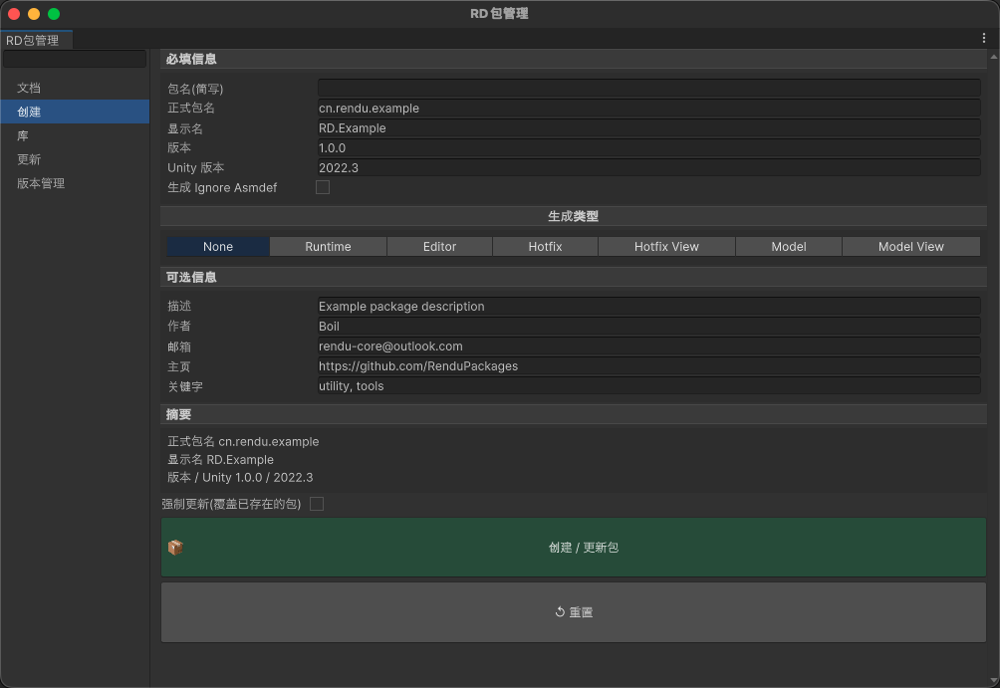
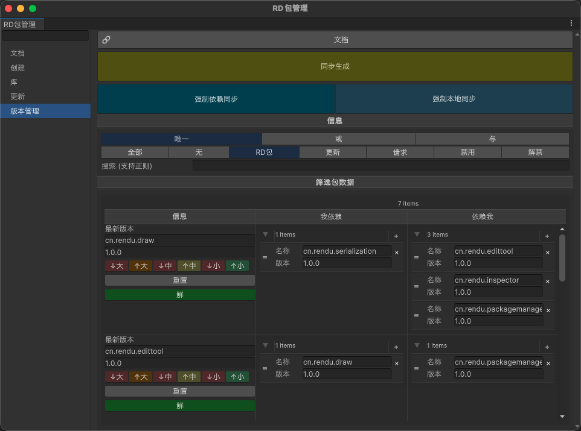
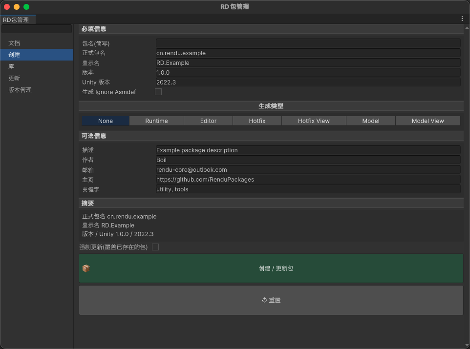
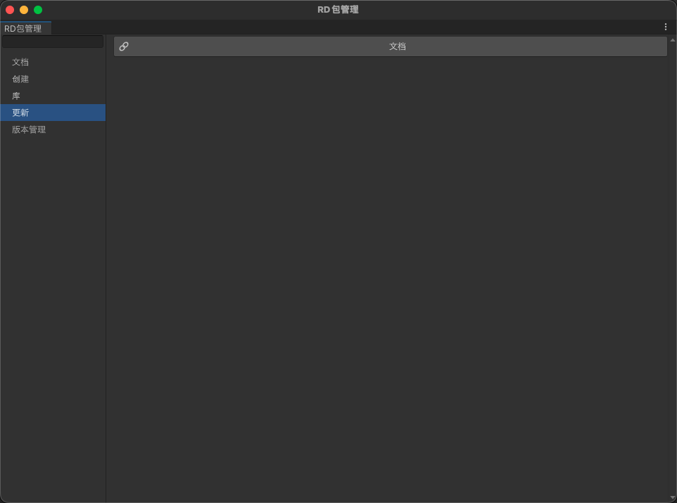

# RD.PackageManager 使用教程

本教程讲**怎么用**；后台结构与模块拆分见 `ArchitectureDesign.md`。所有结论都按当前源码（`Packages/cn.rendu.packagemanager/`）逐条核对过。

---

## 目录

- [第 0 章 这是什么](#第-0-章-这是什么)
- [第 1 章 打开工具](#第-1-章-打开工具)
- [第 2 章 主窗口结构](#第-2-章-主窗口结构)
- [第 3 章 模块详解](#第-3-章-模块详解)
- [第 4 章 独立窗口](#第-4-章-独立窗口)
- [第 5 章 工具链串联](#第-5-章-工具链串联)
- [第 6 章 资产与持久化](#第-6-章-资产与持久化)
- [第 7 章 常见问题](#第-7-章-常见问题)
- [第 8 章 实操场景](#第-8-章-实操场景)

---

## 第 0 章 这是什么

`RD.PackageManager` = 一套内嵌在编辑器里的 **RD 系包管理集成工具**，用来：

- 浏览 / 分类所有 `cn.rendu.*` 包（库模块）；
- 管理每个包的**版本与依赖**，并批量同步到各包 `package.json`（版本管理模块）；
- 用向导**创建新包**（创建模块 / 包创建窗口）；
- 检查远端**可更新版本**（更新模块 / 更新检查窗口）；
- 一键串接 **RD 工具链**（修依赖 → 重生成工程 → Proto2CS）。

| 项 | 值 |
|---|---|
| 包标识 | `cn.rendu.packagemanager` |
| displayName | `RD.PackageManager` |
| 当前版本 | `1.0.2` |
| 上层依赖 | `cn.rendu.draw` / `cn.rendu.edittool` / `cn.rendu.serialization` / `cn.rendu.utilities`（均 `1.0.0`） |
| 入口 | 全部在 `RD/PackageManager/` 菜单下，**不会自动打开** |

---

## 第 1 章 打开工具

三个入口都在 `RD/PackageManager/` 菜单：

| 菜单 | 作用 | 实现类 |
|---|---|---|
| `RD/PackageManager/包管理集成工具/打开`（priority 150） | 打开主集成窗口 | `RDPackageManagerWindow`（`GenericToolWindow` 子类） |
| `RD/PackageManager/包创建`（100） | 打开“包创建”独立窗口 | `RDPackageCreateWindow`（`EditorWindow`） |
| `RD/PackageManager/更新检查`（110） | 打开“更新检查”独立窗口 | `RDPackageUpdateWindow`（`EditorWindow`） |

关闭入口：

| 菜单 | 作用 |
|---|---|
| `RD/PackageManager/包管理集成工具/关闭`（151） | 关主窗口（关后 `Assets/Refresh`） |
| `RD/PackageManager/关闭更新检查`（111） | 关更新检查窗口（窗口出错打不开时用它救场） |

---

## 第 2 章 主窗口结构

主窗口继承自 `cn.rendu.edittool` 的 `GenericToolWindow`，它提供**左树 + 右面板 + 模块扫描 + 选中调度 + 上次选中持久化**。你只需写“模块类”并挂 `[ToolMenu]`，GenericToolWindow 会自动把它扫进左侧菜单树 —— 本包自带 5 个模块：

| 模块（`[ToolMenu]`） | 顺序 | 作用 |
|---|---|---|
| `文档`（`[ToolMenu("文档", -int.MaxValue)]`） | 最前 | 打开飞书文档 / 说明入口 |
| `库`（`[ToolMenu("库")]`） | 中（0） | 拉取所有 RD 包目录，按分类浏览 |
| `创建`（`[ToolMenu("创建")]`） | 中（0） | 创建新包 |
| `更新`（`[ToolMenu("更新")]`） | 中（0） | 更新相关操作 |
| `版本管理`（`[ToolMenu("版本管理", 1000)]`） | 最后 | 版本 / 依赖管理与批量同步 |

> 左侧菜单树由 GenericToolWindow 扫描 `[ToolMenu]` 自动生成；选中项会持久化（关窗再开仍在）。模块类统一继承 `BaseToolModule`，`Initialize()` 在选中时调用，`OnDestroy()` 在离开时调用。

> 界面以 Unity 编辑器内的实际显示为准；以下配图来自真实运行截图（非示意图）。



---

## 第 3 章 模块详解

### 3.1 库（Hub）

进入 / 初始化时自动：

1. `PackageHelper.CheckUpdateAll(...)` 拉取所有 RD 包最新数据；
2. `PackageHubHelper.CheckUpdate(...)` 构建分类树：
   - **All**：全部包；
   - **Custom**：按包自身 category 字段归类的自定义分类；
   - **Other**：未归类的包。
3. 默认选中 `All`，进入该分类的包列表（`PackageCategoryModule`），点某分类即切换。

退出模块时 `PackageHubHelper.SaveAsset()` 落盘。拉取失败会弹错误提示，关窗重试即可。

### 3.2 版本管理（Version）—— 最常用

UI 完全由 attribute 驱动，拆成 3 个 partial 文件：

| 文件 | 承载内容 |
|---|---|
| `RDPackageVersionModule.cs` | 筛选条件 + 包列表 + 把改动写回 `package.json` |
| `RDPackageVersionModule_Sync.cs` | `强制依赖同步` / `强制本地同步` |
| `RDPackageVersionModule_UpdateAll.cs` | 批量“更新当前所有” |

**数据模型要点（最容易踩坑）**：界面编辑的是 `PackageVersionAsset` 的**深拷贝**（`m_AllPackageInfoDataDic`）。只有点 **`同步生成`** 才会把版本 / 依赖真正写回各包的 `package.json`。所以“界面改了但磁盘没变”= 没点同步生成。

**筛选区**（在 `信息` 分组，请求完成后才出现）：

| 控件 | 类型 | 说明 |
|---|---|---|
| 操作类型 | `EPackagesFilterOperationType` | 全部 / 仅（Only：一次只保留一个筛选类型） |
| 类型 | `EPackagesFilterType` | RD / 自定义 / 其他 / 可更新（Update）… |
| 搜索 | 字符串（支持正则，自动转小写） | 按包名过滤 |

**操作按钮**（请求完成后出现）：

| 按钮 | 颜色 | 作用 |
|---|---|---|
| `同步生成` | 黄 | 把当前界面上的版本 / 依赖改动写回各包 `package.json`（有确认弹窗） |
| `文档` | — | 打开飞书文档 |
| `强制依赖同步` | 青 | 把版本号变更**沿依赖图递归传播**（`SyncRefPackages`） |
| `强制本地同步` | 青 | 当前实现 = 关窗 → 卸载资源 → 重开窗；**不做联网**（旧联网逻辑已注释保留） |
| `更新当前所有` | 绿 | 仅当筛选=Update 且有结果时出现；对可更新包做**覆盖式**批量更新（删旧目录 → 改依赖版本 → 请求服务端）。**覆盖模式，风险高** |

> `Only` 模式的单选是通过“当前选集与上一次选集做位差”实现的（见 `OnFilterTypeChanged`），不是枚举原生单选。

### 3.3 创建 / 更新 / 文档 模块

- **创建**：填写包信息并生成新包骨架（与“包创建窗口”同一套逻辑 `PackageViewModel` / `PackageCreateHelper`，区别在渲染层用 RD 自绘检视器）。
- **更新**：更新相关操作，见模块内 UI。
- **文档**：打开飞书文档入口（同更新检查窗口里的“RDPackageManager 包管理文档”按钮）。

---

## 第 4 章 独立窗口

### 4.1 包创建窗口（`RDPackageCreateWindow`）

菜单 `RD/PackageManager/包创建`，纯 IMGUI 窗口，流程：

1. 输入**包名（简写）**，输入走防抖（`PackageInputChangedHandler`）：若已存在同名包会自动载入其信息；
2. **正式包名 / 显示名** 为只读（由简写或已载入信息派生）；
3. 可填字段：版本、Unity 版本（默认取当前 Unity 大版本 `主.次`）、Assembly 定义类型、Assembly 引用类型、代码模式、是否生成 Ignore Asmdef、描述、作者 / 邮箱 / 主页、关键字；
4. `创建/更新包` 按钮；若 `Packages/<正式包名>` 已存在且未勾选 `强制更新(覆盖已存在的包)`，会报错拦截。

校验失败弹错误；成功后在 `Packages/<正式包名>` 生成包并 `AssetDatabase.Refresh()`。

### 4.2 更新检查窗口（`RDPackageUpdateWindow`）

菜单 `RD/PackageManager/更新检查`。打开即 `PackageHelper.CheckUpdateAll`，列出所有 `cn.rendu.*` 包中**远端版本高于本地**的：

```
[cn.rendu.xxx 1.0.0] >> [1.0.1]
```

另有“RDPackageManager 包管理文档”按钮直达飞书 wiki。窗口出错打不开时，用 `RD/PackageManager/关闭更新检查` 先关再开。

---

## 第 5 章 工具链串联

`PackageExecuteMenuItemHelper.RDAll()` 按顺序执行 RD 工具链菜单（每个都用 `try/catch` 包裹，失败只记 `LogError`，不中断后续）：

1. `RD/Init/RepairDependencies` —— 修依赖
2. `RD/Loader/ReGenerateProjectFiles`
3. `RD/Loader/ReGenerateProjectAssemblyReference`
4. `RD/Loader/UpdateScriptsReferences`
5. `RD/Proto/Proto2CS`（`RD/Excel/ExcelExporter` 当前已禁用，改为手动）

> 顺序**不能乱**（注释里写明“有顺序的 别乱动”）。库 / 版本模块的“更新全部”会调用 `RDAll()`。

---

## 第 6 章 资产与持久化

| 资产 | 内容 | 读写方 |
|---|---|---|
| `PackageHubAsset` / `PackageHubData` | 包目录缓存（分类、全部包） | 库模块 |
| `PackageVersionAsset` / `PackageVersionData` / `DependencyInfo` | 版本与依赖信息 | 版本模块（深拷贝编辑，仅“同步生成”落盘） |

筛选条件 / 搜索记忆在 `PrefsValue`（EditorPrefs），关窗保留。

---

## 第 7 章 常见问题

| 现象 | 原因 / 处理 |
|---|---|
| 主窗口一直“请求所有包最新数据中…” | 首次需联网拉取；失败会弹错误，关窗重试 |
| 改了版本号但磁盘 `package.json` 没变 | 没点 `同步生成`（界面改的是副本） |
| `更新当前所有` 后依赖对不上 | 它是覆盖更新，先 `强制依赖同步` 传播版本 |
| 包创建提示“已存在” | 勾选 `强制更新` 覆盖，否则换名 |
| 更新检查窗口打不开 | 用 `RD/PackageManager/关闭更新检查` 先关再开 |
| 工具链某步报错 | 看 `LogError` 里的菜单路径，手动在 `RD/` 菜单执行那一项排查 |

> 反馈：若本教程与界面实际不符，请以源码（`Packages/cn.rendu.packagemanager/Editor/`）为准，并顺手修正本文件。

---

## 第 8 章 实操场景

下面三个场景按"打开 → 操作 → 落盘确认"的顺序走，照着做即可。配图均来自真实运行截图。

### 8.1 场景一：给某包升版本并同步依赖

目标：把 `cn.rendu.foo` 从 `1.0.0` 升到 `1.0.1`，并让依赖它的包也跟着更新版本约束。

1. 菜单 `RD/PackageManager/包管理集成工具/打开` 打开主集成窗口（见第 2 章图）。
2. 左侧菜单树选 `版本管理`（排在最后那项）。
3. 等"请求所有包最新数据中…"结束——**筛选区与操作按钮只有在请求完成后才出现**。
4. 筛选区：搜索框输入 `foo`（支持正则、自动转小写）；类型选 `RD` 缩小范围。
5. 包列表里找到 `cn.rendu.foo`，把版本号从 `1.0.0` 改成 `1.0.1`。
   > ⚠️ 此时改的是 `PackageVersionAsset` 的**深拷贝**，磁盘上的 `package.json` 还没变。
6. 点黄色 `同步生成`（有二次确认弹窗）→ 版本 / 依赖写回各包 `package.json`。
7. 若有别的包依赖 `cn.rendu.foo`，点青色 `强制依赖同步` → 版本号沿依赖图递归传播（`SyncRefPackages`）。
8. 确认落盘：打开 `Packages/cn.rendu.foo/package.json`，`version` 已是 `1.0.1`；依赖方 `package.json` 里 `cn.rendu.foo` 的版本约束也已更新。



### 8.2 场景二：新建一个包

目标：创建一个 `cn.rendu.bar` 的包骨架。

1. 菜单 `RD/PackageManager/包创建` 打开包创建窗口。
2. 输入**包名（简写）** `bar`——输入走防抖；若已存在同名包会自动载入其信息。
3. 正式包名 `cn.rendu.bar`、显示名会**自动派生且只读**，无需手填。
4. 按需填写：版本、Unity 版本（默认当前大版本 `主.次`）、Assembly 定义类型、Assembly 引用类型、代码模式、是否生成 Ignore Asmdef、描述、作者 / 邮箱 / 主页、关键字。
5. 点 `创建/更新包`。若 `Packages/cn.rendu.bar` 已存在且未勾选 `强制更新(覆盖已存在的包)`，会报错拦截。
6. 成功后，在 `Packages/cn.rendu.bar/` 生成包骨架并 `AssetDatabase.Refresh()`。



### 8.3 场景三：批量检查并更新

目标：看看哪些包有远端更新，必要时覆盖式批量更新。

1. 菜单 `RD/PackageManager/更新检查` 打开更新检查窗口——打开即 `PackageHelper.CheckUpdateAll`，列出所有 `cn.rendu.*` 中远端高于本地的包：
   ```
   [cn.rendu.xxx 1.0.0] >> [1.0.1]
   ```
2. 回到主窗口，选 `版本管理` 模块；筛选类型选 `可更新(Update)`，列表只留可更新项，绿色 `更新当前所有` 按钮出现。
3. 点 `更新当前所有` → 对可更新包做**覆盖式**批量更新（删旧目录 → 改依赖版本 → 请求服务端）。
   > ⚠️ 覆盖模式、风险高。更新前先 `强制依赖同步` 保证依赖对得上。
4. 窗口出错打不开时，用 `RD/PackageManager/关闭更新检查` 先关再开。


