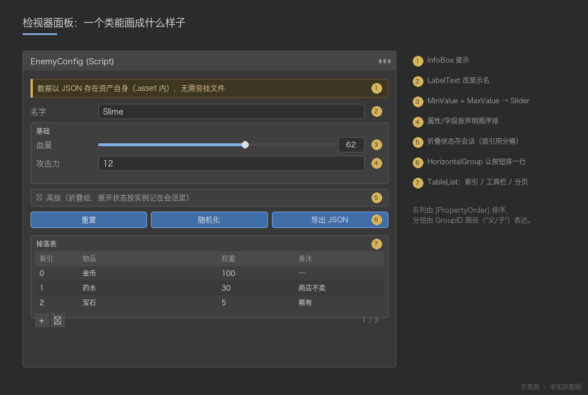
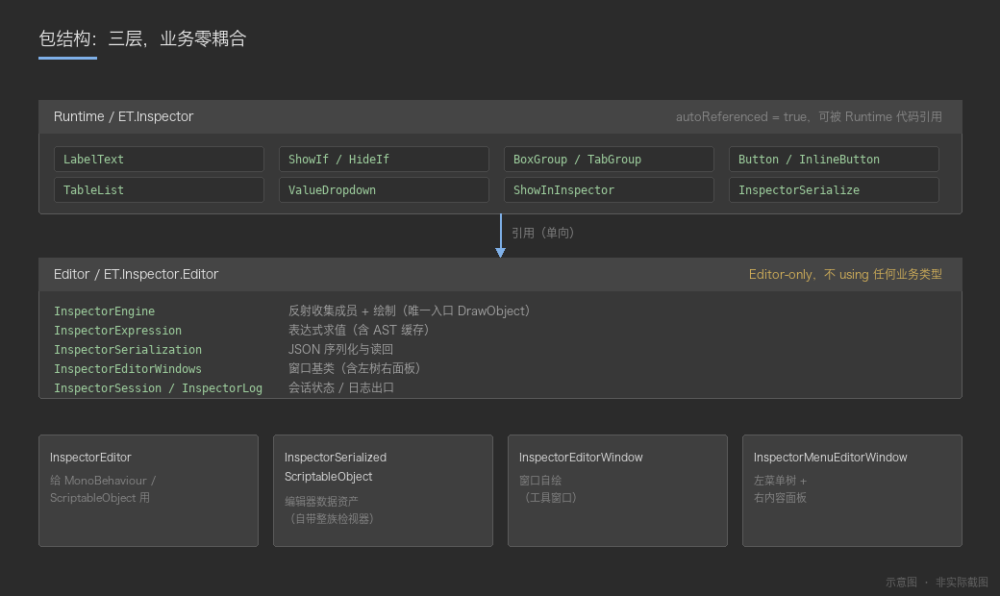
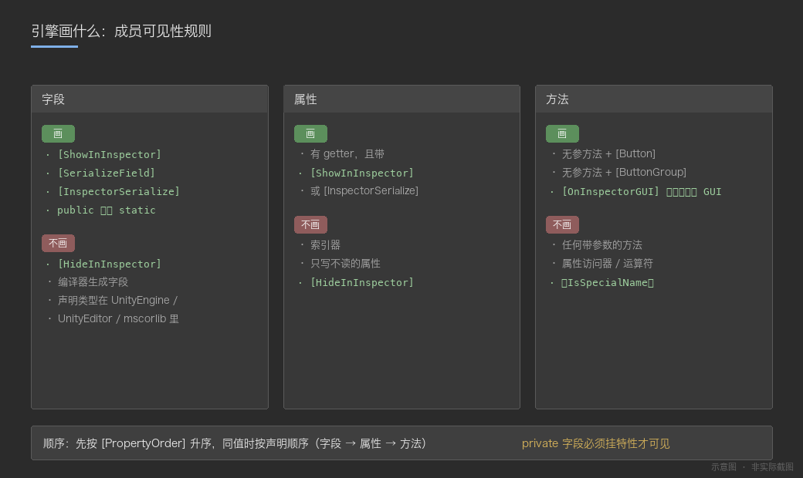
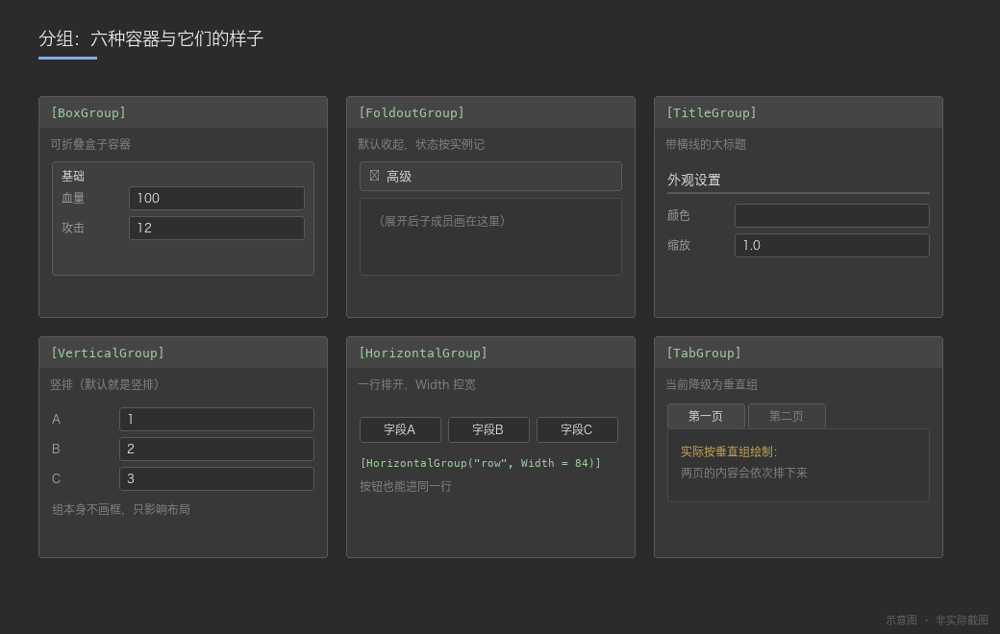
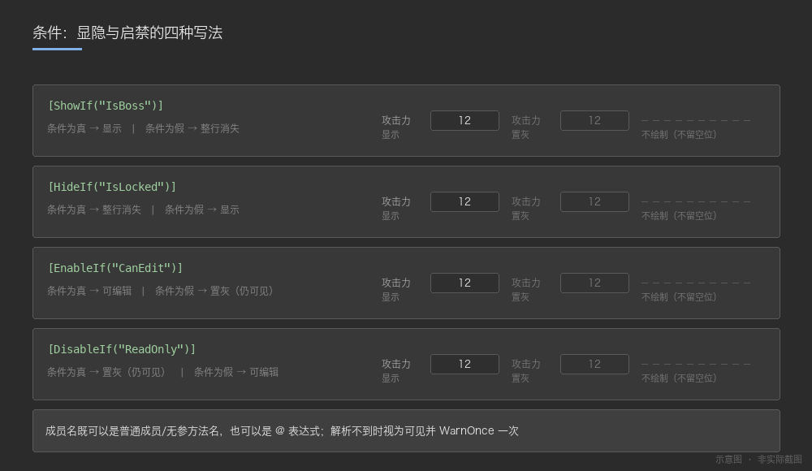
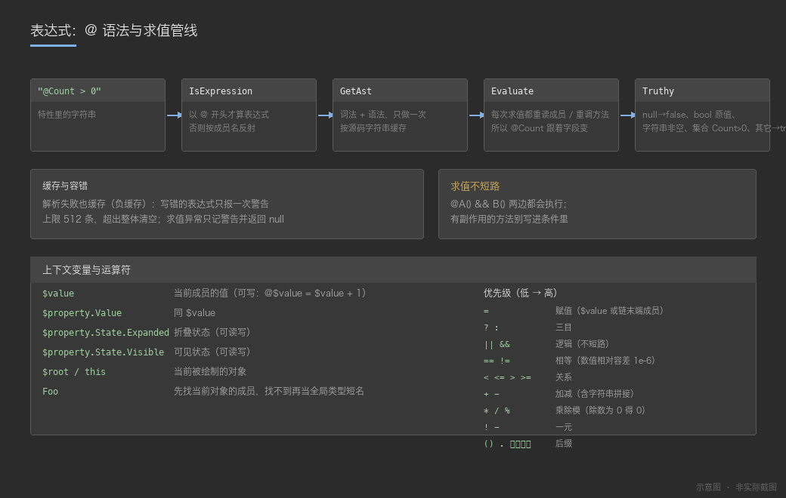

# RD.Panel

`cn.rendu.panel`（displayName **RD.Panel**，version **3.0.0**，最低 Unity **2022.3**）是一个**属性面板绘制引擎包**：不引用任何业务类型，可以整包拎到任意 Unity 工程里直接用。

它提供两样东西：

1. **一套属性特性（Attribute）**（`Runtime/`，纯数据无逻辑）：写在字段 / 属性 / 方法 / 类上，控制编辑器里的显示名、分组、条件显隐、按钮、下拉、表格等；
2. **一套反射式绘制引擎**（`Editor/`）：唯一入口 `Engine.DrawObject`，把任意对象（`MonoBehaviour` / `ScriptableObject` / 普通 C# 对象 / 窗口自身）画成一张属性面板。引擎把"画什么"通过 `IPanelDriver` 抽象出去，包内自带 **IMGUI** 与 **UI Toolkit** 两套实现，可在两者之间切换（见 §2.4）。

> 宿主按挂载位置分在两个独立包，都只依赖本包：**cn.rendu.inspector**（检视器宿主：`InspectorEditor` / `SerializedScriptableObject`）、**cn.rendu.edittool**（工具窗口宿主：`MenuEditorWindow` 等）。本包程序集名是 `RD.Panel` / `RD.Panel.Editor`；检视器宿主包 cn.rendu.inspector 的程序集是 `RD.Inspector.Editor`（命名空间同名，没跟着改）。

> **第一次使用请先看教程**：[`Documentation~/Tutorial.md`](Documentation~/Tutorial.md) —— 从零接入、到写出自己的工具窗口，按步骤走并有排错手册；本文件是特性手册，适合查阅。
>
> 设计取向：特性名与用法与 Odin Inspector 兼容（便于迁移），但**零第三方依赖**（纯 C# + Unity API）。
> 文档里每个特性的"生效情况"都是照引擎源码逐项核对过的实测结论，不是照抄 Odin 文档 —— 哪些参数当前没读取，下文都明确标出。



*图 1：同一个类里的字段、分组、按钮、表格 —— 引擎按特性把它们画出来（示意图，非截图）。*

---

## 目录

- [1. 包结构与程序集](#1-包结构与程序集)
- [2. 三种接入方式](#2-三种接入方式)
- [3. 引擎画什么：成员可见性规则](#3-引擎画什么成员可见性规则)
- [4. 特性速查表](#4-特性速查表)
- [5. 表达式系统（`@` 语法）](#5-表达式系统-语法)
- [6. 编辑器资产序列化：SerializedScriptableObject](#6-编辑器资产序列化inspectorserializedscriptableobject)
- [7. 编辑器窗口与菜单树](#7-编辑器窗口与菜单树)
- [8. 辅助 API](#8-辅助-api)
- [9. 登记检视器](#9-登记检视器)
- [10. 已知限制与注意事项](#10-已知限制与注意事项)
- [11. 完整示例](#11-完整示例)
- [12. 附录：关键实现位置](#12-附录关键实现位置)
- [13. 测试](#13-测试)

---

## 1. 包结构与程序集

```
cn.rendu.panel/
├── package.json                     包元信息（name / displayName / version）
├── README.md                        本文件（特性手册）
├── Documentation~/                  文档资源（Unity 不导入 `~` 结尾的目录）
│   ├── Tutorial.md                  使用教程（怎么用：第 13 章排错、第 14 章选型）
│   ├── images/                      文档配图
│   └── generate_images.py           生成这些配图的脚本
├── Tools~/Verify/                   离线校验工程（不开 Unity 跑测试，见 §13）
├── Runtime/
│   ├── RD.Panel.asmdef              程序集：RD.Panel
│   ├── Attributes/                  全部特性定义（纯数据，无逻辑）
│   │   ├── CoreAttributes.cs        LabelText / HideLabel / ShowInInspector / ReadOnly / PropertyOrder / DisplayAsString / InspectorSerialize ...
│   │   ├── GroupAttributes.cs       PropertyGroup(基类) / BoxGroup / FoldoutGroup / VerticalGroup / HorizontalGroup / ButtonGroup / TitleGroup / TabGroup
│   │   ├── ConditionAttributes.cs   ShowIf / HideIf / EnableIf / DisableIf
│   │   ├── ButtonAttributes.cs      Button / InlineButton
│   │   ├── DropdownAttributes.cs    ValueDropdown / ValueDropdownItem<T> / ValueDropdownList<T>
│   │   ├── EventAttributes.cs       OnValueChanged / OnInspectorInit / OnInspectorGUI / OnStateUpdate
│   │   ├── ListAttributes.cs        TableList / TableColumnWidth / ListDrawerSettings / DictionaryDrawerSettings / EnumToggleButtons
│   │   ├── TextAttributes.cs        InfoBox / DetailedInfoBox / Title
│   │   ├── ValueAttributes.cs       MinValue / MaxValue / LabelWidth / GUIColor / Required / HideInPlayMode / HideInEditorMode
│   │   ├── MiscAttributes.cs        InlineEditor / FolderPath / FilePath / HideInTables
│   │   ├── Enums.cs                 InfoMessageType / TitleAlignments / ButtonStyle / TextAlign / IconAlignment
│   │   └── SdfIconType.cs           按钮图标枚举
│   └── Utilities/CollectionExtensions.cs    HashSet<T>.AddRange
├── Editor/
│   ├── RD.Panel.Editor.asmdef       程序集：RD.Panel.Editor（Editor 平台）
│   ├── Engine/                      引擎层（反射收集成员 + 绘制 + 表达式）
│   │   ├── Engine.cs                核心引擎，唯一入口 DrawObject；含 HostState 句柄
│   │   ├── Expression.cs            `@` 表达式词法 / 语法 / 求值 + 共用的值语义 Value
│   │   ├── HostSession.cs           一次检视会话的编辑期状态（折叠 / 滚动）
│   │   ├── HostState.cs             跨程序集宿主持有的不透明状态句柄
│   │   └── Log.cs                   统一日志出口（含 WarnOnce 去重）
│   ├── Drawing/                     绘制后端层（IPanelDriver 契约 + 两套实现）
│   │   ├── IPanelDriver.cs          立即模式契约：把"画什么"的决策翻译成本地 UI 的一次次调用
│   │   ├── ImGuiDriver.cs           IMGUI 实现（EditorGUILayout）
│   │   ├── UitkDriver.cs            UI Toolkit 实现（按位置复用 VisualElement）
│   │   ├── Drawing.cs               后端选择 / 切换的全局门面（UseIMGUI / UseUIToolkit / SetDefaultFactory）
│   │   └── PanelSpec.cs             控件描述符（PanelTextSpec / PanelButtonSpec 等，跨后端复用）
│   └── Controls/                    控件层
│       └── Icons.cs                 内置图标 + SdfIconType → Texture 解析
└── Tests/Editor/                    EditMode 测试（程序集：RD.Panel.Tests.Editor，引擎侧 4 夹具 115 例）

检视器宿主（InspectorEditor / SerializedScriptableObject / Serialization + 19 例测试）
在 cn.rendu.inspector 包；窗口宿主在 cn.rendu.edittool 包。
```

### 程序集依赖

| 程序集 | 引用 | 说明 |
|---|---|---|
| `RD.Panel` | 无 | 纯特性定义，Runtime 可用（`autoReferenced = true`） |
| `RD.Panel.Editor` | `RD.Panel` | **Editor-only**。全包没有任何 `[MenuItem]`，也没有任何 `[CustomEditor]`（检视器宿主在 cn.rendu.inspector 包）：画什么、入口在哪，全部由使用方决定 |
| `RD.Panel.Tests.Editor` | 前两者 | 仅测试用；通过 `InternalsVisibleTo` 访问引擎的 internal 元数据 |

> 结论：**Runtime 代码只需要引用 `RD.Panel`**（用特性）；**写自定义宿主的 Editor 代码要引用 `RD.Panel.Editor`**（引擎）；现成宿主在两个独立包 —— 检视器宿主 **cn.rendu.inspector**（程序集 `RD.Inspector.Editor`）、工具窗口宿主 **cn.rendu.edittool**（`EditorWindowBase` / `MenuEditorWindow` / `MenuTree` / `EditorPrefsValue<T>`），引包即用。
> 如果工程用 asmdef 组织代码，Editor 目录可以通过 **Assembly Definition Reference（`.asmref`）** 归并进自己的 Editor 程序集，从而天然拥有这些能力。



*图 2：Runtime 只放特性，Editor 只放引擎（宿主在另外两个包），业务类型永远不出现在这套包里。*

---

## 2. 三种接入方式

### 2.1 给 MonoBehaviour / ScriptableObject 接检视器

> `InspectorEditor` 在 **cn.rendu.inspector**（检视器宿主包，程序集 `RD.Inspector.Editor`）；命名空间 `RD.Inspector.Editor` 不变，本节的代码写法照旧。

写一个继承 `RD.Inspector.Editor.InspectorEditor` 的类，用 Unity 原生 `[CustomEditor]` 注册：

```csharp
using RD.Inspector.Editor;
using UnityEditor;

[CustomEditor(typeof(EnemyConfig))]
public class EnemyConfigEditor : InspectorEditor { }
```

用 `true` 一次覆盖整个继承族（子类无需再登记）：

```csharp
[CustomEditor(typeof(EnemyConfigBase), true)]
public class EnemyConfigBaseEditor : InspectorEditor { }
```

`InspectorEditor` 的行为（其源码注释已明确）：

- 内部调用 `Engine.DrawObject(target, null, OnBeforeChange, OnChanged)`，把反射写值前后的时机交给宿主做 Undo / `SetDirty` / 重绘；
- **刻意不做全局注册**（没有 `[CustomEditor(typeof(MonoBehaviour), true)]`），避免替换掉全工程其它脚本的 Unity 原生检视器 —— 用哪个组件要自己显式登记；
- 基类必须写全 `UnityEditor.Editor`：该文件位于 `RD.Inspector.Editor` 命名空间内，简单名 `Editor` 会被解析成 `RD.Inspector` 下的 `Editor` 命名空间，报 CS0118。

### 2.2 编辑器数据资产（ScriptableObject）

> `SerializedScriptableObject` 与序列化器 `Serialization` 同在 **cn.rendu.inspector**（检视器宿主包）。

编辑器侧的数据资产推荐继承 `SerializedScriptableObject`，把成员标 `[InspectorSerialize]`：

```csharp
using RD.Panel;                           // 特性命名空间
using UnityEditor;                        // Editor 程序集里才有的基类

public class MyEditorAsset : SerializedScriptableObject
{
    [InspectorSerialize]
    [LabelText("名字")]
    private string m_Name;
}
```

- 基类自带 `[CustomEditor(typeof(SerializedScriptableObject), true)]`，**子类无需自己写检视器**；
- 基类位于 **Editor 程序集**，所以只能用于编辑器资产；**运行时资产不要继承它** —— 运行时资产用 `ScriptableObject` + 公共字段 / `[SerializeField]`；
- 数据细节见 [第 6 节](#6-编辑器资产序列化inspectorserializedscriptableobject)。

### 2.3 编辑器窗口

窗口宿主已迁至独立包 **`cn.rendu.edittool`**（程序集 `RD.EditTool.Editor`，命名空间 `RD.EditTool.Editor`）：`EditorWindowBase`、`MenuEditorWindow`、`MenuTree`、`EditorPrefsValue<T>`。

- 窗口包引用 `RD.Panel` / `RD.Panel.Editor`，用 `Engine.DrawObject` 绘制窗口自身与右侧面板；
- 跨程序集宿主各持独立会话的入口：`Engine.CreateHostState()` 创建不透明状态句柄，绘制时传 `DrawObject(target, host, onBeforeChange, onChanged, state)`，各窗口的折叠 / 滚动状态互不串台；
- 用法详见该包的 README。

> **本包自身不提供任何菜单入口**（全包没有任何 `[MenuItem]`）。窗口入口一律由使用方提供。

### 2.4 绘制后端：IMGUI / UI Toolkit 切换

引擎只按 [`IPanelDriver`](Editor/Drawing/IPanelDriver.cs) 这一套**立即模式的语义调用**画东西（`BeginBox` / `Label` / `IntField` / `Button` / `Foldout` / `BeginScroll` / `BeginCheck` …），具体的本地 UI API 由后端实现，因此同一份绘制逻辑可以落在任意 UI 系统里。包内已提供两套：

| 后端 | 类 | 说明 |
| --- | --- | --- |
| IMGUI（默认） | `ImGuiDriver` | 平移原本的 `EditorGUILayout` 调用，行为与旧版一致 |
| UI Toolkit | `UitkDriver` | 把调用序列落到一棵 `VisualElement` 树上，按位置复用元素（见下方注意） |

三种切换粒度，从粗到细：

```csharp
// 1) 全局默认: 整包都走它(不传 driver 的 DrawObject 都受影响)
Drawing.UseIMGUI();       // 回到默认
Drawing.UseUIToolkit();   // 整包切到 UI Toolkit

// 2) 单个窗口: 多传一个 driver, 只这一个窗口走它
public void OnGUI()
{
    Engine.DrawObject(this, this, OnBeforeChange, OnChanged, new UitkDriver(rootVisualElement));
}

// 3) 自己实现后端: 换别的 UI 系统不用改引擎
Drawing.SetDefaultFactory(host => new MyDriver(host));
```

`UitkDriver` 的宿主协作方式与 IMGUI 不同，接之前要知道：

- **需要重绘时必须重新调用 `DrawObject`**。IMGUI 每帧 `OnGUI` 天然如此；UI Toolkit 是保留模式，数据变了却没有再绘制，界面不会自己更新。窗口宿主用它时要自己排一次重绘；两个宿主的开关都收在各自包内，业务代码不用碰 —— 检视器宿主（cn.rendu.inspector）是菜单 Tools / RD Inspector / UI Toolkit 绘制 或 `InspectorBackend.UseUIToolkit`，窗口宿主（cn.rendu.edittool）是菜单 Tools / RD EditTool / UI Toolkit 绘制 或 `WindowBackend.UseUIToolkit`，详见各自包的 README。
- **UI Toolkit 渲染不了的部分会降级**：`Label` 不支持富文本（`[DisplayAsString]` 的 richText 按纯文本显示），按钮图标只支持 `Texture2D`。
- 元素按**位置**复用（容器内同一位置仍是同类控件就只更新内容与状态），所以折叠 / 条件显隐变化时不会整树重建，正在输入的输入框不丢焦点；反之中间插入不同控件时那一个会被换掉。

---

## 3. 引擎画什么：成员可见性规则

引擎按类型缓存成员清单（`Dictionary<Type, CachedMember[]>`），规则如下：

### 字段

跳过条件（任一命中即不画）：

- `[HideInInspector]`
- 编译器生成字段（闭包 / 自动属性背后的字段等）
- 成员声明类型所在程序集以 `UnityEngine` / `UnityEditor` / `mscorlib` 开头（框架内部字段，如 `wantsMouseMove`）

显示条件（任一命中即画）：

- `[ShowInInspector]`
- `[SerializeField]`
- `[InspectorSerialize]`
- `public` 且**非 static**

> 推论：**private 字段必须挂特性才可见**；**public static 字段默认不显示**（但挂 `[ShowInInspector]`/`[SerializeField]` 即可显示，不必改写成属性）；不带任何特性的 private 字段默认隐藏（与 Unity 原生行为一致，但比 Odin 更严格）。另有 `IsEngineInternal` 兜底：声明类型在 `UnityEngine*`/`UnityEditor*`/`mscorlib` 里的成员一律跳过，所以继承 `MonoBehaviour`/`ScriptableObject`/`EditorWindow` 不会把引擎基类字段带进面板。

### 属性

- 必须同时满足：有 getter，且带 `[ShowInInspector]` 或 `[InspectorSerialize]`；`[HideInInspector]` 优先跳过。访问器可见性不影响收集（`[ShowInInspector] private int X { get; set; }` 一样会画）。
- 索引器：引擎收集阶段不专门过滤，但要挂标记才会被收集、且读值需要索引实参 → **实践上不要给索引器挂标记**（序列化器则会直接跳过 `GetIndexParameters().Length > 0` 的属性）。

### 方法

- 只有**无参**方法会被收集（带参数的方法直接忽略）。
- 带 `[Button]` / `[ButtonGroup]` → 画成按钮；带 `[OnInspectorGUI]` → 在该位置调用（用来插入自定义 GUI）。
- 属性访问器、运算符等 `IsSpecialName` 方法跳过。

### 顺序

1. `[PropertyOrder(double)]` 升序；
2. 相同 order 时按**收集顺序**（`Seq`）：**字段 → 属性 → 方法**，同类内部是反射返回的元数据顺序（通常等同声明顺序，但非语言保证；`FlattenHierarchy` 下自己声明的成员一般排在基类成员之前）。要精确控序请显式写 `[PropertyOrder]`。

### Unity 对象成员

- 成员类型是 `UnityEngine.Object` 时**默认不内窥**（只作为普通对象引用绘制），除非标了 `[InlineEditor]`；
- **曲线 / 渐变不算"嵌套对象"**：`AnimationCurve` / `Gradient` 的数据在原生对象里，按普通类展开只会画出一堆无意义的句柄成员，因此它们直接走 `CurveField` / `GradientField`（序列化的对应规则见 §6）；
- 根对象例外：宿主是 `EditorWindow` 时允许自绘窗口自身；
- 引擎有深度上限与环检测（"正在绘制"集合 + parent 判定），自引用 / 循环引用会被剪断；**绘制侧上限 `Engine.MaxDepth = 24`**（序列化侧是 32，见第 6 节）；
- 折叠（展开）状态存在会话里（`HostSession`，成员状态按宿主对象弱引用分桶），域重载后回到默认展开。



*图 3：字段 / 属性 / 方法各自的"画与不画"判定（示意图）。*

---

## 4. 特性速查表

命名空间统一为 `using RD.Panel;`。下表「生效」列指**当前引擎是否真的读取该参数**（依据引擎源码逐项核对）。

### 4.1 名称 / 标签 / 排序

| 特性 | 作用目标 | 用法 | 生效情况 |
|---|---|---|---|
| `[LabelText("文本")]` | 全部 | 改显示名 | 生效。字段标签按 **成员自身 → 成员类型（只认枚举）→ `FriendlyName`** 三级回退，见 §4.1 表下注；枚举**值**上的用法见 §4.5 |
| `[HideLabel]` | 全部 | 不画标签 | 生效。容器（列表 / 字典 / 集合 / 表格）另有约定：**折叠头**只保留计数（`▼ (3)` —— 箭头总要一段可点的文字），**非折叠的纯文本头**整行不画（不留空白带） |
| `[PropertyOrder(double)]` | 全部 | 排序权重 | 生效 |
| `[ReadOnly]` | 全部 | 只读 | 生效 |
| `[ShowInInspector]` | 字段/属性（放方法上无效果，方法请用 `[Button]`/`[OnInspectorGUI]`） | 让非序列化成员也参与绘制 | 生效（静态字段靠它显示） |
| `[InspectorSerialize]` | 字段/属性/类 | 参与绘制 + 参与 JSON 序列化 | 生效（见第 6 节） |
| `[LabelWidth(float)]` | 全部 | 标签宽度 | 生效 |
| `[DisplayAsString(bool overflow = true)]` | 全部 | 以文本显示值 | 部分：`MaxCharCount` 生效（超长截断加 `...`）、`Alignment`（`TextAlign`）生效（居中/右对齐/左对齐）；`Overflow` / `AlignLabel` 当前未读取 |
| `[InlineEditor(bool expanded)]` | 全部 | 内联展开嵌套对象（`[HideLabel]` 时连表头都不画） | 生效（注意：Runtime 里该特性的注释写着"占位/空操作"，已过时） |
| `[HideReferenceObjectPicker]` | 类/结构/字段/属性 | 隐藏引用选择器 | **未实现**（引擎本就没有引用选择器，用户类型一律按实际类型内联展开，等价于始终隐藏） |
| `[HideMonoScript]` | 类 | 隐藏 Script 栏 | **未实现**（引擎从不绘制 Script 引用栏，没有可隐藏的东西） |
| `[Searchable]` | 类/结构/字段/属性 | 成员搜索 | **未实现** |
| `[OnInspectorInit]` | 全部 | Inspector 初始化回调 | **未实现** |
| `[HideInTables]` | 全部 | 表格内隐藏 | **未实现** |

> 字段标签的解析顺序（`GetLabel`）：**成员自身的 `[LabelText]`** → **成员「类型」上的 `[LabelText]`（只认枚举）** → `FriendlyName`。第二级是给"一个泛型基类承载 N 个枚举"这类场景准备的：那 N 个字段声明的其实是同一个成员、连名字都一样，唯一能区分的只有各自的枚举类型（典型：`cn.rendu.ui` 的 `MacroDataBase<T>`，宏分组行靠它显示成 `RD` / `UI` / `资源加载`，而不是 N 行一样的文字）。类/结构上的 `[LabelText]` **不**参与这一级 —— 它的语义是类型自身的显示名（`[AddComponentMenu]` 那一类），拿来当字段标签会把类引用字段的标签改成组件名。
>
> 不写 `[LabelText]` 时的默认标签来自 `FriendlyName`：正则 `(?<!^)([A-Z][a-z0-9])` → ` $1`，即**只在"大写 + 小写/数字"这一对之前插空格，首字符除外**。于是 `AttackSpeed` → `Attack Speed`、`m_AttackSpeed` → `m_ Attack Speed`（**不去前缀**）、而 `MaxHP` / `URL` / `WaveID` 这类**连续大写不会被拆**。私有字段与连续大写的字段建议显式写 `[LabelText]`。

### 4.2 分组

所有分组特性都派生自 `PropertyGroupAttribute`，核心语义：

- `GroupID` 支持 `"父/子"` 路径 → 用它表达**嵌套分组**；`GroupName` 只是路径最后一段（用于显示）；
- `Order` 决定同级分组先后；
- `HideWhenChildrenAreInvisible`（默认 `true`）：组内成员**全部**不可见时整组不画；
- 同类型 + 同 `GroupID` 的分组会被**合并成同一个组**（因此同组多个字段各写一次特性是正常的写法）。

| 特性 | 关键参数 | 效果 | 生效情况 |
|---|---|---|---|
| `[BoxGroup("名字")]` | `ShowLabel`、`CenterLabel` | 可折叠盒子容器（`[BoxGroup(" ")]` 可以用来做无标题分隔盒） | 生效 |
| `[FoldoutGroup("名字", expanded)]` | `Expanded`（默认 false） | 折叠组 | 生效 |
| `[VerticalGroup("名字")]` | `PaddingTop/PaddingBottom` | 垂直排列 | 生效（Padding 两项未读取） |
| `[HorizontalGroup("名字")]` | `Width` | 水平排列（把多个字段 / 按钮排一行） | 生效；`Width` **未读取**（行宽由内容与窗口决定，不能靠它定宽） |
| `[ButtonGroup("名字")]` | — | 同组按钮排一行 | 生效 |
| `[TitleGroup("名字")]` | `Alignment`、`HorizontalLine`、`BoldTitle` | 带横线的大标题分组 | 生效（`IndentChildren` 未读取）。`Alignment`：`Left`/`Centered`/`Right` 生效；分组没有副标题，`Split` 退化为 `Left` |
| `[TabGroup("页签名")]` | — | 页签分组 | **降级实现**：引擎当前把它当作垂直组绘制（源码注释原话："页签分组暂按垂直组降级"） |



*图 4：分组特性的实际视觉效果；注意 `TabGroup` 当前是垂直组降级（示意图）。*

`PropertyGroupAttribute` 上的 `VisibleIf`（可见性表达式）**已生效**：写在任意分组特性上，条件不满足时**整组**不绘制，且与 `HideWhenChildrenAreInvisible` 无关，所以不会留下一个空框；子组被它隐藏时，父组也不会再被判定为"还有内容"。写法同 `[ShowIf]`（支持 `@` 表达式与裸成员名）：

```csharp
[FoldoutGroup("高级", VisibleIf = "@ShowAdvanced")]   // 表达式
[BoxGroup("外观", VisibleIf = "HasAppearance")]        // 成员名
```

同在这条基类上的 `AnimateVisibility` **仍未读取**（显隐不带过渡动画）。

### 4.3 条件显隐 / 启禁

四种特性签名一致：`(string memberName)` 或 `(string memberName, object value)`：

```csharp
[ShowIf("ShowDeleteBtn")]                       // 成员为 true 时显示
[ShowIf("ViewMode", ViewMode.Advanced)]         // 成员等于该值时显示（枚举/数值/字符串都能比）
[HideIf("IsLocked")]                            // 成员为 true 时隐藏
[EnableIf("CanEdit")]                           // 成员为 true 时可编辑
[DisableIf("ShowDeleteBtn")]                    // 成员为 true 时禁用
```

- `memberName` **既可以是普通成员名，也可以是 `@` 开头的表达式**（引擎会先判断 `IsExpression`，是表达式就走表达式求值，否则反射取成员值）；
- 无参方法也可以（引擎按"无参方法"取值）；
- `[ShowIf].Animate` 参数当前**未读取**（不校验、不报错，只是没有动画）。



*图 5：`ShowIf` / `HideIf` / `EnableIf` / `DisableIf` 在条件成立与不成立时的表现（示意图）。*

### 4.4 按钮与回调

| 特性 | 用法 | 生效情况 |
|---|---|---|
| `[Button("文字", 高度)]` | 方法上，画成按钮；支持命名参数 `Icon = SdfIconType.X`、`Tooltip = "..."` | `ButtonName`/`ButtonHeight`（默认 24）/`Icon`/`Tooltip` 生效；`ButtonStyle`、`IconAlignment` **未读取**（图标统一居左，引擎注释："Unity ImagePosition 没有 ImageRight"）。注意 `Icon` 只有少数字形族有映射（见 §11.2），其余值是纯文本按钮 |
| `[InlineButton("方法名", "标签")]` | 把按钮画在某个成员同一行 | 生效 |
| `[ButtonGroup("组名")]` | 一组按钮排同一行 | 生效 |
| `[OnValueChanged("方法名")]` | 值变化后回调（字段/属性） | 生效；`IncludeChildren` **未读取** |
| `[OnInspectorGUI]` / `[OnInspectorGUI("方法名")]` | 在绘制序列里调用该方法，用来插入自定义 GUI（可多次） | 生效（用 `[PropertyOrder]` 控制插入位置） |
| `[OnStateUpdate("...")]` | 每帧更新成员状态；参数是 `@` 表达式时求值（例如 `@$property.State.Expanded = true`），否则当作无参方法名直接调用 | 生效，但**只有 `State.Expanded` 会被读回**并作用于折叠状态（`State.Visible`/`Enabled`/`Selected` 写进去没有效果，自动显隐请用 `[ShowIf]`） |

按钮 / 回调执行前会走引擎的 `Mutate`，因此宿主（`InspectorEditor`）能统一做 Undo 快照与标记脏。

> 注意：Unity 自带的 `[Tooltip("...")]` **引擎不读取**（不会显示悬停提示）。需要提示请用 `[InfoBox]` / `[DetailedInfoBox]`，或给按钮用 `Tooltip = "..."` 命名参数。

### 4.5 数值 / 校验 / 颜色 / 运行模式

| 特性 | 用法 | 生效情况 |
|---|---|---|
| `[MinValue(double)]` + `[MaxValue(double)]` | 两者**同时**存在且都传数值时，数值成员画成 `Slider` | 生效，但仅限"两个数值版本同时存在"；任一侧用 `MemberName` 重载时退回普通输入框（成员名不会被取值） |
| `[LabelWidth(float)]` | 标签宽度 | 生效 |
| `[GUIColor(r,g,b,a)]` / `[GUIColor("1,0,0,1")]` | 行着色；字符串形式只接受 `"r,g,b[,a]"` 数字串 | 生效；`GUIColorAttribute.MethodName` **未读取**（写"返回 `Color` 的方法名"不会着色，也不会报错） |
| `[Required("自定义错误")]` | 空 / 默认值时提示 | 生效（`ErrorMessage`、`MessageType` 都读取） |
| `[EnumToggleButtons]` | 枚举画成按钮组 | 生效（`GUILayout.Toolbar`；不带该特性时是 `EditorGUILayout.Popup`）。补充事实：**枚举值上可以挂 `[LabelText("中文")]` 定制显示文本**（`GetEnumLabel` 会读）；**枚举「类型」上挂 `[LabelText("中文")]` 则它成为该枚举字段的字段名**（字段自身未写标签时，见 §4.1 表下注）；`[Flags]` 枚举目前只能单选一个值（无按位多选界面）；当前值匹配不上任何选项时下拉显示第 0 项但**不改数据** |
| `[HideInPlayMode]` / `[HideInEditorMode]` | 运行时 / 编辑时隐藏 | 生效 |

### 4.6 列表 / 字典 / 表格

| 特性 | 关键参数 | 生效情况 |
|---|---|---|
| `[TableList]` | 单元格**只画值、不画字段名**（字段名由列名承担，见 `LabelForControl`）；`DrawScrollView`、`AlwaysExpanded`、`HideToolbar`（隐藏工具栏=隐藏删除/添加）、`ShowIndexLabels`、`NumberOfItemsPerPage`（默认 15，仅配合 `DrawScrollView` 决定滚动视图一次显示几行；可见行数 = `Clamp(数据条数, 3, NumberOfItemsPerPage)`，**空表也留 3 行**的数据位 —— 只留 1 行时表头 + 横向滚动条一占就只剩一条缝；滚动区高度 = (数据行 + 表头行) × 行高 + 横向滚动条 + 表头分隔线） | 以上参数**均生效**；`IsReadOnly` 读取（与工具栏联动）；`ShowPaging` / `ShowItemCount` **未读取** |
| `[TableColumnWidth(int width)]` | 表格中该成员的列宽 | `Width` 生效；`Resizable` **未读取**（列不可拖拽调宽） |
| `[ListDrawerSettings]` | `CustomAddFunction`（自定义"添加"方法名） | 主要只实现 `CustomAddFunction` 与 `IsReadOnly`；`ShowPaging`/`ShowItemCount`/`ShowFoldout`/`DefaultExpandedState`/`ShowIndexLabels`/`HideAddButton`/`HideRemoveButton`/`DraggableItems`/`NumberOfItemsPerPage`/`CustomRemoveIndexFunction`/`CustomRemoveElementFunction`/`OnBeginListElementGUI`/`OnEndListElementGUI`/`OnTitleBarGUI` **当前未读取** |
| `[DictionaryDrawerSettings(keyLabel, valueLabel)]` | 字典绘制 | 引擎识别该特性；`IsReadOnly` **生效**；`KeyLabel`/`ValueLabel`/`DisplayMode` 当前**未读取** |
| `[ValueDropdown("获取方法")]` | 从方法返回的 `ValueDropdownList<T>` / 集合里出下拉 | `ValuesGetter` 生效；`AppendNextDrawer`/`IsUniqueList`/`ExcludeDuplicates`/`DoubleClickToConfirm`/`HideValuesInChildTree` 当前**未读取** |

列表 / 字典的实际能力边界（容易误判成"应该有"的地方，逐条与 `DrawPlainList` / `DrawDictionary` 对齐）：

- **没有拖拽排序**（全引擎无拖拽代码）：列表只有 `+` 追加与逐元素 `-` 删除；`DraggableItems` 等参数未读取。要排序请在元素里放 `Order` 字段自己排；
- **标量元素是文本输入框**：`int`/`float`/`bool`/`string`/枚举 靠 `ParseSimple` 解析回值，**解析失败静默不写**；`Vector2`/`Vector3`/`Color` 被算作标量但 `ParseSimple` 无分支 → 文本框敲了不生效（`Vector4`/`Quaternion`/`Rect`/`LayerMask` 不在标量判据里，反而会嵌套展开、可编辑）；
- **`list[0]` 是 `UnityEngine.Object` 的列表走只读分支**（判据是首元素类型）：用 `ObjectField` 展示，控件返回值被丢弃，且没有 `+`/`-`/折叠标题 —— 空列表时还是普通列表（有 `+`），一旦有元素就再也删不掉；元素为 `null` 时只画只读文本、连 `-` 都没有；
- **字典没有 `+`**（不能新增键值对）、**键不可编辑**；值只有标量能改（文本框），非标量值退化成只读 `LabelField`。要"可增删的配置表"请改用 `List<Entry>` + `[TableList]`；
- **`[TableList]` 在元素类型没有可表格化成员时静默退回普通列表**；
- `+` 的默认实现是 `Activator.CreateInstance(T)`，失败只记警告。

下拉列表数据的写法：

```csharp
[ValueDropdown("GetTeamSelectList")]
[OnValueChanged("OnTeamChanged")]
internal int TeamId;

private IEnumerable GetTeamSelectList()
{
    var showValues = new ValueDropdownList<int>();
    foreach (var team in TeamTable.All)
    {
        showValues.Add(team.DisplayName, team.Id);   // (显示文本, 值)
    }
    return showValues;
}
```

### 4.7 路径选择

| 特性 | 用法 | 生效情况 |
|---|---|---|
| `[FilePath]` / `[FilePath("ext 过滤器")]` | 文件选择面板（`EditorUtility.OpenFilePanel`） | `Extensions` 生效；`ParentFolder`/`RequireExistingPath` 未读取 |
| `[FolderPath]` | 文件夹选择 | 引擎识别并绘制；`Parent`/`FixedName`/`RequireExistingPath` 当前**未读取** |

### 4.8 提示与标题

| 特性 | 用法 |
|---|---|
| `[InfoBox("信息", InfoMessageType.Warning)]` | 提示框（`None/Info/Warning/Error`） |
| `[DetailedInfoBox("摘要", "详情", InfoMessageType.Info)]` | 详细提示（⚠️ **不是可展开控件**：引擎画的是同一个 `HelpBox`，内容为 `摘要 + "\n" + 详情`） |
| `[Title("标题", "副标题")]` | 在成员上方画标题；`Subtitle`、`HorizontalLine`、`Bold`、`Alignment` 均生效。`Alignment`：`Left`/`Centered`/`Right` 整体对齐；`Split` = 主标题靠左、副标题同一行靠右（无副标题时退化为 `Left`） |

`InfoBox` / `DetailedInfoBox` 的 `VisibleIfMemberName` **已生效**（`@` 表达式或裸成员名，同 `[ShowIf]`）：条件不满足时整条提示不绘制。`TitleAttribute` 上并没有这个参数，标题始终显示。

---

## 5. 表达式系统（`@` 语法）

引擎里有三处会真正做**表达式求值**：

1. `[OnStateUpdate("...")]` 的 `Action`；
2. 条件类特性的成员名 —— `[ShowIf]/[HideIf]/[EnableIf]/[DisableIf]`（`ConditionValue`）；
3. 分组特性 `PropertyGroup` 上的 `VisibleIf`（见 4.2），走的也是 `ConditionValue`。

**判定规则：字符串以 `@` 开头才算表达式**（`ExpressionEvaluator.IsExpression`）。不带 `@` 的参数一律按"成员名 / 方法名"反射处理。



*图 6：从特性里的字符串到布尔结果 —— 解析只做一次，求值每次都重读数据（示意图）。*

### 5.1 上下文变量

| 写法 | 含义 |
|---|---|
| `$value` | 当前成员的值（**只读**：`@$value = x` 只改表达式内部的临时值，不会写回字段） |
| `$property.State.Expanded` / `.Selected` / `.Visible` / `.Enabled` | 当前成员的 GUI 状态。都可以写，但引擎**只读回 `Expanded`**，其余三项写入后没有效果 |
| `$property.Value` | 同 `$value` |
| `$root` / `this` | 当前被绘制的对象 |
| 裸标识符 `Foo` | 先在当前对象上找字段 / 属性（含静态），找不到再当**全局类型短名**（扫描所有程序集，例如 `Mathf.PI`） |
| `true` / `false` / `null` | 字面量 |
| `'文本'` / `"文本"` | 字符串（支持 `\n \t \r` 转义） |
| `123` / `1.5` / `1e3` | 数字 |

赋值（`=`）只认两种左值：`$property.State.X`，以及**带 `.` 的链末端成员**（如 `@$root.SomeField = 1`）。裸 `@Count = 1` 不会写（没有链可写），`$value = x` 也不会写回字段。另外表达式赋值**不经过宿主的 Undo / SetDirty 回调**，且每帧执行会覆盖用户输入 —— 因此除视图状态（折叠）外不建议用它改数据。

没有 `target` / `value` 这类无 `$` 前缀的保留名 —— 写成 `target` 会去当前对象上找名为 `target` 的成员。

### 5.2 运算符（优先级由低到高）

```
=                       赋值（只认能落到"真实对象"上的链末端成员，如 `@$root.Field = 1`、`@$property.State.Expanded = false`；`@$value = 1` 只改本次求值的上下文副本，不写回字段）
? :                     三目
||                      逻辑或
&&                      逻辑与
== !=                   相等（数值相对容差 1e-6；枚举可与字符串名比较）
< <= > >=               关系
+ -                     加减（任一侧是 string 则做字符串拼接）
* / %                   乘除模（除数为 0 时返回 0）
! -                     一元
() . 方法调用            后缀：括号分组、成员链、带参/无参方法调用
```

**不支持**：`++`/`--`、复合赋值（`+=`）、按位运算（`& | ^ ~ << >>`）、类型转换 `(T)x`、`is`/`as`、数组/集合字面量。
方法匹配只按"名字 + 参数个数"，不校验参数类型；找不到就返回 `null`。

> **求值不短路**：`@A() && B()` 两边都会执行。有副作用的方法不要写进条件表达式。

### 5.3 示例

```csharp
[ShowIf("@Count > 0 && IsReady()")]          // 成员 + 方法 + 算术
[ShowIf("@State == \"Running\"")]            // 枚举与字符串名比较
[ShowIf("@Name != null && Name != ''")]      // 字符串与 null
[HideIf("@!_isExpanded")]                    // 取反
[EnableIf("@Level >= 10 ? true : false")]    // 三目

[OnStateUpdate("@$property.State.Expanded = Count > 0")]     // 按数据自动展开/收起（唯一会被读回的状态）
// [OnStateUpdate("@$property.State.Visible = IsVisible()")] 目前无效: 引擎只读回 Expanded, 自动显隐请用 [ShowIf]
```

### 5.4 容错

求值被 `try/catch` 包裹：词法出错（字符串未闭合、非法字符、数字解析失败）或求值异常时，会记一条警告（`Log.Warn`）并返回 `null`，**不会中断绘制**。布尔上下文使用 `Truthy`：`null`→false、`bool` 原值、字符串非空、`UnityEngine.Object` 非 fake-null、集合 `Count > 0`、其它→true。

### 5.5 解析只做一次（AST 缓存）

表达式每帧都会重新判定，但**词法 + 语法分析只做一次**：AST 按源码字符串缓存（`ExpressionEvaluator.s_AstCache`），稳态下每帧只剩遍历求值。缓存的是**元数据**，不是取值结果 —— 每次求值照样重新读成员、重新调用方法，所以 `@Count` 能跟着字段变化。

解析失败也缓存（负缓存）：写错的表达式只报**一次**警告，之后按空表达式处理（返回 `null`，条件判定为假）。没有这条负缓存，一个拼错的表达式会每帧重新词法分析一遍、每帧重报一条日志。缓存上限 512 条，超出整体清空（`Evaluate` 是公开 API，若被塞进动态拼出来的字符串则缓存会无界增长）。

同一层的成员/方法解析（`(类型, 名字) → 字段 / 属性 / 无参方法`）也带缓存，见 §10。

> 记日志这件事本身也被 `try/catch` 包住（`Log`）：Unity 的 `Debug.*` 是内部调用，在非 Unity 进程里调用会抛 `SecurityException`。包住它，包内的离线校验工程（`Tools~/Verify`）才能覆盖到这些告警路径 —— 表达式求值、序列化、引擎的告警现在都走这一个出口。它另外提供 `WarnOnce(key, message)`：条件显隐与表达式是每帧重算的，同一件事（同一个拼错的表达式、同一个解析不到的成员名、同一个没有可序列化成员的类型）只报一次，否则控制台会被刷爆、用户反而看不到第一条。

### 5.6 值语义只有一份实现（`Value`）

真值 / 数值判定 / 相等这三件事由 `Value`（`Editor/Engine/Expression.cs` 顶部）统一定义，**条件显隐（`[ShowIf]` 等）与表达式求值共用同一套规则**，因此同一个值不会在两处得到相反结论。

数值相等用**随量级放大的相对容差**（`NumericTolerance = 1e-6`），不是 `==` 也不是 `double.Epsilon`：

- 字段常是 `float`，而特性参数与表达式字面量是 `double` —— `0.1f` 转 `double` 是 `0.100000001490116…`，与 `0.1` 差约 `1.5e-9`。绝对容差 `1e-9` 恰好卡在门外，会让 `[ShowIf("Speed", 0.1)]` 在 `float` 字段上**永远不成立**；
- 容差必须随量级放大：`1e9` 附近的 `float` 相邻值间隔远大于任何固定绝对容差。

---

## 6. 编辑器资产序列化：`SerializedScriptableObject`

> 本节内容（`SerializedScriptableObject` 与序列化器 `Serialization`）已迁至**检视器宿主包 cn.rendu.inspector**，完整细节见该包 README。要点回顾：

- 普通字段走 Unity 原生序列化；`[InspectorSerialize]` 标记的与 public / `[SerializeField]` 的**复杂成员**（Dictionary、嵌套 POCO、HashSet 等）走 `EditorJsonUtility` JSON 落盘，存进同一个 asset；
- 继承族自带检视器，子类无需再登记；
- 行为契约由随包迁移的 `SerializationTests`（19 例）钉住；"Unity 属性包类型（曲线/渐变）"的判定 `Engine.IsUnityPropertyBagType` 留在本包引擎侧（绘制与序列化共用同一条规则）。

---

## 7. 编辑器窗口与菜单树（已迁出）

`EditorWindowBase` / `MenuEditorWindow` / `MenuTree` / `EditorPrefsValue<T>` 已迁至独立包 **`cn.rendu.edittool`**（命名空间 `RD.EditTool.Editor`，详见该包 README）；菜单树建树规则（路径自动补齐、同名就地替换、深度优先遍历、选中事件）的行为契约也随包迁移（`MenuTreeTests`，14 例）。

引擎侧不变的承诺：`Engine.DrawObject` 仍接受 `EditorWindow host`（传窗口实例表示窗口自绘），窗口包的右侧面板就是用它绘制任意普通 C# 对象 —— **任何 `class` 都能直接当面板内容**，`[Button]` 照常出按钮。

---

## 8. 辅助 API

| API | 说明 |
|---|---|
| `Drawing.UseIMGUI()` / `Drawing.UseUIToolkit()` | 全局切换默认后端（持久到进程内，跨窗口生效；检视器宿主有自己的开关，不受全局影响） |
| `Drawing.SetDefaultFactory(Func<EditorWindow, IPanelDriver>)` | 自己实现 `IPanelDriver` 并注册到全局，不用改引擎就能接别的 UI 系统 |
| `Icons.FromSdf(SdfIconType)` | 把 `SdfIconType` 转成 `Texture`（优先映射 Unity 内置图标，映射不到返回 `null`，按钮退化为纯文本） |
| `Icons.Folder` / `SettingsCog` | 现成图标（`EditorIcon` 结构，可隐式转 `Texture` / `GUIContent`） |
| `CollectionExtensions.AddRange<T>(this HashSet<T>, IEnumerable<T>)` | `HashSet` 批量添加（Runtime 侧） |
| `ExpressionEvaluator.IsExpression(string)` / `Evaluate(...)` / `EvaluateBool(...)` / `Truthy(object)` | 表达式工具，可在业务代码里复用 |

`Engine` 的公开 API：

```csharp
// 基本入口
public static void DrawObject(object target,
                              EditorWindow host,
                              Action<object> onBeforeChange = null,
                              Action<object> onChanged = null);

// 跨程序集宿主(例如 cn.rendu.edittool 的窗口)各持独立状态:
public static HostState CreateHostState();
public static void DrawObject(object target,
                              EditorWindow host,
                              Action<object> onBeforeChange,
                              Action<object> onChanged,
                              HostState state);
```

- `target`：要绘制的对象（可以是窗口自身）；
- `host`：宿主窗口。传 `null` 表示宿主是 `UnityEditor.Editor`（根对象可为 `MonoBehaviour`/`ScriptableObject`）；传窗口实例表示窗口自绘；
- `state`：`CreateHostState()` 发的不透明句柄，宿主自己持有、生命周期与宿主一致；传 `null` 走默认会话；
- `onBeforeChange`：数据**即将写入前**回调 → 宿主在此拍 Undo 快照；
- `onChanged`：数据**已修改后**回调 → 宿主标记脏、登记 prefab override、请求重绘。

---

## 9. 登记检视器

引擎不做任何全局注册，所以"哪个类型用这套检视器"必须显式登记 —— 一行 `[CustomEditor]` 即可：

```csharp
[CustomEditor(typeof(EnemyConfig))]
public class EnemyConfigEditor : InspectorEditor { }

[CustomEditor(typeof(EnemyConfigBase), true)]    // true = 覆盖整个继承族
public class EnemyConfigBaseEditor : InspectorEditor { }
```

**一次覆盖整族的范例**（宿主包 cn.rendu.inspector 自带）：`Editor/Inspector/SerializedScriptableObjectEditor.cs` 用一行覆盖了 `SerializedScriptableObject` 的全部子类：

```csharp
[CustomEditor(typeof(SerializedScriptableObject), true)]
public class SerializedScriptableObjectEditor : InspectorEditor { }
```

于是任何继承 `SerializedScriptableObject` 的资产都自动获得本包检视器，子类不必再写检视器代码。

> **为什么不做全局注册**（例如 `[CustomEditor(typeof(MonoBehaviour), true)]`）：那会替换掉全工程其它脚本的 Unity 原生检视器。通用包不应该替使用方做这种决定 —— 登记什么类型属于使用方的知识。

---

## 10. 已知限制与注意事项

### 来自 `InspectorEditor` 的固有限制（反射写值的代价，源码注释原文）

1. **不显示预制体覆盖（override）标记**，也无法用右键菜单还原单个属性；
2. **不做多对象差异编辑**，多选时只绘制第一个对象（会给出 `HelpBox` 警告）；
3. **Undo 粒度**由本类在"写入前"自行拍快照（一次交互一条），与 `SerializedProperty` 的行为略有差别。

### 其它

- 反射改值绕过了 `SerializedProperty`，`InspectorEditor` 里已用 `EditorUtility.SetDirty` + `PrefabUtility.RecordPrefabInstancePropertyModifications` 兜底；**自己写宿主（例如直接用 `Engine.DrawObject`）必须自己实现 `onChanged`**，否则改动不会落盘；
- 引擎**不绘制** `UnityEngine.Object` 成员内部的字段（除非 `[InlineEditor]`）；
- **private 字段必须挂特性**（`[SerializeField]`/`[ShowInInspector]`/`[InspectorSerialize]`）才可见；**public static 字段默认不显示**（挂特性即可显示）；**基类的 `private` 字段永远收不到**（`FlattenHierarchy` 对非公开实例成员只覆盖 `protected`，实测确认），继承体系请用 `protected`/`public`；
- **方法必须无参**才会被 `[Button]`/`[OnInspectorGUI]` 识别；`[Button]` / `[OnValueChanged]` / `CustomAddFunction` / 表达式的方法名解析同样只认无参版本（按形参个数挑）—— **同名重载不会再抛 `AmbiguousMatchException`**（`Type.GetMethod(name, flags)` 在重载时必抛，实测），带参方法直接判为"没有"（用 null 参数调用本来就执行不了）；被 `new` 隐藏的成员按"取最派生"这条确定规则解析（`Type.GetMember` 一次查返回的是成员数组、顺序未定义）；
- 条件里的成员名解析不到（写错名字）时的语义是**视为可见**（宁可不隐藏，也不因一个拼错的名字把成员整片吞掉），并在首次遇到时记一条 `WarnOnce` 点出"哪个类型、哪个名字没解析到" —— 这条路径以前是完全静默的：成员一直显示，谁也想不到是名字写错了；
- 引擎按类型缓存成员与分组树，**新增成员后需要等域重载**（改动代码本来就会触发编译）；
- 绘制热路径上的重复工作都有缓存，**稳态零分配**：成员清单、分组树、表格列之外，还包括"每个成员按特性类型筛选出的特性数组"（`CachedMember.GetAttrs<T>`）、标题 / 分组头 / `DisplayAsString` 的 `GUIStyle`（按锚点×加粗分档缓存）、按钮与下拉的 `GUIContent`（立即模式单线程复用）、枚举下拉的标签数组与 toggle 按钮内容（按枚举类型缓存）、"`(类型, 名字, 形参个数) → 无参方法 / 字段 / 属性`"的反射查找结果（引擎与表达式求值器共用同一份解析规则与缓存），以及表达式的 AST 与索引器元数据（见 §5.5）。缓存同样活到域重载，所以上面那条"靠域重载生效"对它们一并适用；
- 折叠状态、滚动位置是会话内缓存（不写盘；窗口的菜单宽度、上次选中项要持久化请用 cn.rendu.edittool 的 `EditorPrefsValue<T>`）；
- 表达式**已支持索引器**（`@Items[0]`、`@Map['key']`、`@Child.Items[1]`，调用结果后也能接，如 `@GetScaled(2)[1]`）：覆盖数组 / 字符串 / `List<T>` / `Dictionary<K,V>` 与自定义 `this[...]` 索引器；**越界或键缺失返回 `null`**，不会中断整段绘制。仍不支持位运算与自增自减；
- 表达式解析会校验收尾：写了一半的表达式（如 `@Items[0`）整体返回 `null`，而不是被静默截断成一个错值；
- 表达式里的数字字面量一律是 `double`；方法调用（`InvokeRaw`）会先按形参类型显式收窄，因此 **`@Foo(1, 2)` 可以调用 `Foo(int, int)`**，`Foo(SomeEnum)` 也能接收整数字面量。收窄只覆盖数值与枚举形参，其余类型原样交给反射 binder；
- 已声明但当前**无实现/无效果**的特性与参数（完整清单）：`[HideReferenceObjectPicker]`、`[HideMonoScript]`、`[Searchable]`、`[OnInspectorInit]`、`[HideInTables]`、`[TabGroup]`（降级为垂直组）、`PropertyGroup.AnimateVisibility`、`ShowIf.Animate`、`OnValueChanged.IncludeChildren`、`GUIColorAttribute.MethodName`、`TableListAttribute.ShowPaging`/`ShowItemCount`、`HorizontalGroupAttribute.Width`、`Button.ButtonStyle`/`IconAlignment`、`TableColumnWidth.Resizable`、`DictionaryDrawerSettings` 的多数参数、`ListDrawerSettings` 的多数参数、`FilePath.ParentFolder`、`FolderPath` 的参数、Unity 原生 `[Tooltip]`；
- 本包**不提供菜单入口**；也不注册针对 `MonoBehaviour`/`ScriptableObject` 的全局检视器覆盖 —— 唯一的 `[CustomEditor(..., true)]` 只挂在 `SerializedScriptableObject` 上（覆盖它自己的继承族，见第 6 节）。业务类型的入口与登记都在使用方。

---

## 11. 完整示例

### 11.1 组件：条件 / 分组 / 表格 / 按钮

```csharp
using System;
using System.Collections.Generic;
using RD.Panel;
using UnityEngine;

[Serializable]
public class DropEntry
{
    [TableColumnWidth(140)]
    public string ItemId;

    [MinValue(0), MaxValue(1000)]
    public int Weight;

    public bool Rare;

    [ShowIf("Rare")]                    // 只在勾选"稀有"时出现
    public string Note;
}

public class EnemyConfig : MonoBehaviour
{
    [VerticalGroup("Key")]
    [DisableIf("ShowDeleteBtn")]
    [OnValueChanged("OnTypeChanged")]
    [ValueDropdown("GetTypeSelectList")]
    [ShowInInspector]
    [ShowIf("ViewMode", ViewMode.Add)]      // 按当前视图模式决定是否出现
    internal int TypeId;

    [VerticalGroup("掉落表")]
    [TableList(DrawScrollView = true, AlwaysExpanded = true, HideToolbar = true)]
    [PropertyOrder(1001)]
    internal List<DropEntry> Drops = new();

    [VerticalGroup("掉落表")]
    [Button("添加一行", 10)]
    [GUIColor(0.7f, 0.4f, 0.8f)]
    [PropertyOrder(1000)]                   // 排在它操作的那张表之前
    private void AddDrop() => Drops.Add(new DropEntry());
}
```

要点：

- 同一个 `VerticalGroup("...")` 名 → 同一个竖列组；
- `[PropertyOrder]` 用来把"按钮"放在它所操作的列表附近（1000 在 1001 之前）；
- `[ShowIf("ViewMode", 枚举值)]` 是按当前视图模式决定该字段是否出现；
- `[TableColumnWidth]` 只对 `[TableList]` 风格的表格列生效。

### 11.2 纯工具窗口

> 基类 `EditorWindowBase` 已迁至 **cn.rendu.edittool**（命名空间 `RD.EditTool.Editor`）；示例里演示的特性与引擎行为不变。

```csharp
using RD.EditTool.Editor;          // EditorWindowBase 所在包

public class MyToolWindow : EditorWindowBase
{
    [Button("打开文档", 30, Icon = SdfIconType.Info)]   // Icon 只有部分字形有映射, 见 §11.2
    [PropertyOrder(-99999)]
    public void OpenDocument() => Application.OpenURL("https://example.com/docs");

    [MenuItem("Tools/My Tool")]
    private static void OpenWindow() => GetWindow<MyToolWindow>("My Tool").Show();

    [Title("模式")]
    [HideLabel]
    [EnumToggleButtons]
    public Mode CurrentMode;

    [HorizontalGroup("Actions")]
    [Button("应用", 30)]
    private void Apply() { }

    [HorizontalGroup("Actions")]
    [Button("回滚", 30)]
    private void Revert() { }
}

public enum Mode { Simple, Advanced }
```

要点：窗口自身的公共字段 / 带特性方法与 `[Button]` 方法都会被绘制；`[HorizontalGroup("Actions")]` 把两个按钮排到同一行。

关于 `SdfIconType`：`Icons.FromSdf` 只映射了下面这些字形族（映射到 Unity 内置图标，缺失时回退到族内别名），**其余任何值都返回 `null`，按钮退化为纯文字**（不报错）：

`Folder*`、`Settings*`/`Gear*`、`Save*`、`Play*`、`Pause*`、`Stop*`、`Refresh`/`Sync`/`ArrowRepeat`、`Search*`、`Plus*`、`Minus*`、`Trash*`、`Exclamation*`、`Info`/`InfoCircle`、`Question*`、`Eye*`、`EyeSlash*`、`Check*`、`ArrowUp`/`ArrowDown`/`ArrowLeft`/`ArrowRight`、`X*`、`Calendar*`。

因此像 `Link45deg`、`Github` 这类常用图标目前**不会显示**——想要就自己往 `Icons.FromSdf` 的 switch 里加映射（返回一个 `Texture` 即可）。

---

## 12. 附录：关键实现位置

| 主题 | 文件（符号名） |
|---|---|
| 绘制入口 / 变更回调 | `Editor/Engine/Engine.cs`（`DrawObject`、`Mutate`） |
| 绘制后端契约（立即模式：Begin/End 配平、值返回语义） | `Editor/Drawing/IPanelDriver.cs` |
| IMGUI 后端实现 | `Editor/Drawing/ImGuiDriver.cs` |
| UI Toolkit 后端实现（按位置复用元素 / 样式残留处理 / 首帧几何 retry） | `Editor/Drawing/UitkDriver.cs` |
| 后端选择 / 切换的全局门面 | `Editor/Drawing/Drawing.cs` |
| 跨后端复用的控件描述符（`PanelTextSpec` / `PanelButtonSpec` 等） | `Editor/Drawing/PanelSpec.cs` |
| 有意不实现的特性说明（含原话） | `Editor/Engine/Engine.cs`（类首"有意不实现的属性"注释段） |
| 成员收集与可见性规则 | `Editor/Engine/Engine.cs`（`GetMembers`） |
| 排序算法（`PropertyOrder` → 声明序） | `Editor/Engine/Engine.cs`（`GetMembers` 内的比较器） |
| 分组树构建 / 整组隐藏 | `Editor/Engine/Engine.cs`（`GetGroupTree`） |
| `TabGroup` 降级为垂直组 | `Editor/Engine/Engine.cs`（`DescribeGroup`） |
| 按钮绘制（含图标/Tooltip/高度/背景色还原） | `Editor/Engine/Engine.cs`（`DrawButton`） |
| 每帧状态更新 | `Editor/Engine/Engine.cs`（`RunStateUpdates`） |
| `[InlineEditor]` 内联展开 / 目标判定 | `Editor/Engine/Engine.cs`（`DrawInlineEditor`、`IsInlineEditorTarget`） |
| `Min/MaxValue` → Slider 判定 | `Editor/Engine/Engine.cs`（`DrawScalarControl` 内的 `EditorGUILayout.Slider` 分支） |
| 标量控件（含 `Vector4`/`Quaternion`/`Rect`/`Bounds`/`LayerMask`/曲线/渐变分支） | `Editor/Engine/Engine.cs`（`DrawScalarControl`） |
| 容器判定（曲线/渐变在此被排除，改走专用控件） | `Editor/Engine/Engine.cs`（`IsContainerType`） |
| 表格绘制（工具栏/索引/每页条数） | `Editor/Engine/Engine.cs`（`DrawTableList`） |
| 列表 `CustomAddFunction` | `Editor/Engine/Engine.cs`（`AddListElement`） |
| 提示框 / 运行模式显隐 | `Editor/Engine/Engine.cs`（`DrawTitlePrelude`、`CheckVisibility`） |
| 无参方法查找与缓存 / 字段属性查找与缓存 | `Editor/Engine/Engine.cs`（`FindMethod`、`ResolveFieldOrProperty`） |
| `GUIColor` / `InlineButton` | `Editor/Engine/Engine.cs`（`ResolveGUIColor`、`DrawInlineButtons`） |
| 条件显隐 / 禁用判定 / 成员名解析不到时的告警 | `Editor/Engine/Engine.cs`（`CheckVisibility`、`GetMemberValue`） |
| 折叠状态与滚动位置的会话存取（按对象弱引用分桶） | `Editor/Engine/HostSession.cs`（`HostSession`） |
| 值语义（真值/数值/相等容差，两份实现合并于此） | `Editor/Engine/Expression.cs`（`Value`） |
| 表达式：AST 缓存与负缓存（上限清空） | `Editor/Engine/Expression.cs`（`AstCacheLimit`、`GetAst`） |
| 表达式：求值入口 / 索引器元数据缓存 | `Editor/Engine/Expression.cs`（`Evaluate`、`s_IndexerCache`） |
| 表达式：赋值节点 | `Editor/Engine/Expression.cs`（`SetLeft`、`SetMember`） |
| 表达式：上下文根解析（`$value`/`$root`/`$property`） | `Editor/Engine/Expression.cs`（`ResolveRoot`） |
| 序列化成员筛选（三条规则：特性 / Unity 值类型 / 属性包） | `Editor/Engine/Serialization.cs`（`GetDataMembers`、`AnnotatedMembers`、`IsUnitySerializableValueType`、`IsUnityPropertyBagType`） |
| 写出与读成员容错（`{}` 告警 / 单成员读失败写 null） | `Editor/Engine/Serialization.cs`（`WriteObject`、`ReadMemberSafe`） |
| 逐成员写回 / 嵌套对象创建（曲线走真实构造函数） | `Editor/Engine/Serialization.cs`（`ApplyMembers`、`CreateInstance`） |
| 统一日志出口（`Debug.*` 保护 + `WarnOnce` 去重） | `Editor/Engine/Log.cs`（`Log`、`WarnOnce`） |
| `UnityEngine.Object` 被写为 null / 深度上限 | `Editor/Engine/Serialization.cs`（`WriteValue`、`MaxDepth`） |
| 检视器宿主与 Undo 处理 | `Editor/Inspector/InspectorEditor.cs`（`InspectorEditor`、`OnBeforeChange`） |
| 整族登记范例 | `Editor/Inspector/SerializedScriptableObjectEditor.cs` |

> 本表故意不写行号：行号会随实现漂移，用 IDE 的"转到符号"或全局搜符号名定位即可。符号名不会腐坏，且可机械校验（把表里每个 `` `符号` `` 拿去对应文件 `grep -w` 一遍即可）。

---

## 13. 测试

包内自带 EditMode 测试（`Tests/Editor/`，程序集 `RD.Panel.Tests.Editor`），覆盖**不依赖 GUI** 的五块纯逻辑，作为后续重构的回归护栏（序列化的 19 例已随宿主迁至 cn.rendu.inspector）：

| 测试文件 | 覆盖对象 |
|---|---|
| `ExpressionEvaluatorTests.cs` | `@` 表达式的词法/优先级/求值/真值语义、`$property` 读写、失败路径、解析缓存（重复求值仍读当前值/仍写回）、按形参个数挑重载、被 `new` 隐藏的成员取最派生、自定义索引器 |
| `EngineReflectionTests.cs` | 引擎骨架：成员可见性规则、`PropertyOrder` → 收集序排序、`GroupID` 路径 → 分组树（嵌套/类型/同级顺序）、类型级缓存、无参方法解析（重载/仅有带参/被 `new` 隐藏）、标签三级回退（成员 `[LabelText]` → 枚举类型 `[LabelText]` → `FriendlyName`）、容器头部文案与 `[HideLabel]`（名字+计数 / 只剩计数 / 整行不画）、表格可见行数与滚动区高度（含"旧公式比内容短几像素"的回归）、标题对齐映射、枚举标签缓存（声明序 + 值级标签 + 同类型命中缓存）、表格单元格的值控件不带标签 |
| `EngineStateTests.cs` | 折叠状态：默认展开、实例/成员/会话间隔离、宿主对象回收后状态随之释放、`OnStateUpdate` 表达式写回与按名调用 |
| `EngineConditionTests.cs` | 条件显隐与禁用：`[ShowIf]`/`[HideIf]` 的真值与相等语义（含数值相对容差，`float` 字段 vs `double` 字面量）、`@` 条件表达式、成员名解析（被 `new` 隐藏的成员取最派生）、多条件"与"、`[EnableIf]`/`[DisableIf]`、两种运行模式下的 `[HideInPlayMode]`/`[HideInEditorMode]` |

### 怎么跑

**Unity 内（推荐）**：`Window > General > Test Runner` → `EditMode` → `Run All`。

**命令行**：

```bash
<Unity 可执行文件> -batchmode -nographics \
  -projectPath <项目根> \
  -runTests -testPlatform EditMode \
  -testFilter RD.Panel.Tests.Editor \
  -testResults <结果.xml> -logFile <日志> -quit
```

**不开 Unity 的快速回归**：包内 `Tools~/Verify/` 是一个独立的 .NET 控制台工程，它把 `Runtime/`、`Editor/`、`Tests/Editor/` 的源码直接编译进一个普通进程（自带极简 NUnit 运行器），只需 .NET 8：

```bash
cd "Packages/cn.rendu.panel/Tools~/Verify" && dotnet run
```

几秒内即可跑完全部纯逻辑断言（表达式、成员收集、折叠状态、条件显隐），无需启动编辑器，全部可在纯 .NET 进程里跑。当前规模：**4 个夹具 115 例，脱机 115 通过 / 0 跳过**（`ExpressionEvaluatorTests` 44、`EngineReflectionTests` 37、`EngineConditionTests` 20、`EngineStateTests` 14）。序列化 19 例在 cn.rendu.inspector（17 通过 / 2 跳过），菜单树 14 例在 cn.rendu.edittool。

运行器接受一个**夹具名子串**作为可选参数（`Program.Main` 的 `args[0]`，大小写不敏感的 `IndexOf` 匹配），只想跑一块时：

```bash
dotnet run -- InspectorExpression      # 只跑 ExpressionEvaluatorTests
dotnet run -- Engine          # 跑两个 Engine*Tests
```

（`--` 后面的参数才会传给程序；不带参数就跑全部。）

它需要 `UnityEngine.dll` / `UnityEditor.dll` 做引用，默认指向 Tuanjie 安装目录，换机器或换 Unity 版本时用属性 / 环境变量指定：

```bash
dotnet run -p:UnityManaged=/Applications/Unity/Hub/Editor/2022.3.62f1/Unity.app/Contents/Managed
UNITY_MANAGED=/path/to/Managed dotnet run
```

### 写测试前必读

- 这些断言固化的是**当前实现的真实行为**，不是"理想行为"。"表达式不短路求值"、"`Truthy(0)` 为真"、"数字字面量一律是 `double`"这类反直觉规则是**故意**钉住的陷阱提示 —— 改实现时先让测试变红，再决定是改断言还是改代码；
- `Serialize_UnityObjectReferenceIsNotPersisted` 依赖 `ScriptableObject`，`RoundTrip_Gradient` 依赖原生对象（**曲线/渐变在纯 .NET 里 `new` 不出来，直接抛 `SecurityException: ECall methods must be packaged into a system module`**），这两个**只能**在 Test Runner 内跑 —— 跳过名单是 `Tools~/Verify/Program.cs` 里的 `RequiresUnityRuntime`。曲线/渐变其余能脱机验证的部分（成员规则、null 语义）只走反射，因此在纯 .NET 下同样有覆盖；
- 测试通过 `Editor/AssemblyInfo.cs` 里的 `InternalsVisibleTo` 访问引擎的 internal 元数据与状态存取方法（`CachedMember` / `GroupNode` / `GetMembers` / `GetGroupTree` / `GetExpanded` / `SetExpanded` / `FindMethod` 等），这样不必让测试去反射私有成员；`internal` 在程序集之外依然不可见，不扩大公共 API；
- 仍然**没有** GUI 层测试：`Engine` 的绘制流程与 `Begin/End` 配平还没有自动化覆盖，改动这些区域依然只能靠 Unity Test Runner 或手工回归（条件显隐规则本身已可脱机验证，见 `EngineConditionTests`；同理，「容器头部画什么文字 / 这一行画不画」已从绘制流程里抽成 `LabelOrEmpty` / `CountedLabel` / `ShouldDrawLabel` 三个纯函数并可脱机验证，留在绘制流程里的只剩 `GUILayout.*` 调用本身）；
- 折叠状态与滚动位置存在 `HostSession`（由宿主持有，`DrawObject` 在绘制期间挂载、退出时还原；未显式传入时用默认会话兜底）：状态的生存期与宿主一致、窗口之间彼此隔离，不再是进程级静态字典；
- 会话内的成员状态按**宿主对象弱引用分桶**（`ConditionalWeakTable<object, ObjectState>`，桶内再按成员名索引）：对象被回收即整桶消失，不会像早期实现那样留下永不释放的键；分桶判定走"引用相等"，也消除了身份哈希被复用后把状态错给新对象的问题（回归用例 `EngineStateTests.FoldedState_OwnerStateIsReleasedWithTheOwner`）；
- 分组展开状态并入同一套分桶（桶内键为 `GroupID` 路径）：此前它挂在会话级平铺字典上，而分组路径在同类型的所有实例上是同一个字符串，于是同一窗口里两个同类型对象（例如列表中的两行）会共用一次折叠。现在 `FoldoutGroup` 的展开逐实例独立（回归用例 `EngineStateTests.GroupExpanded_IsolatedPerInstance`）。
